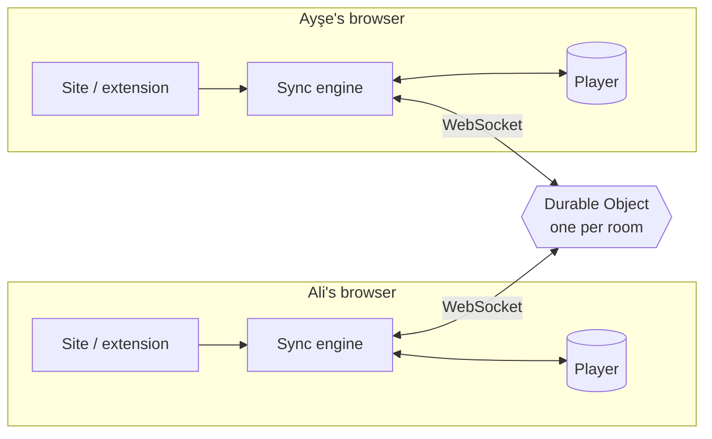

<div align="center">

# ▶ ScreenWithMe

**Watch any video together, in perfect sync.**<br/>
Free · no accounts · no ads · works on YouTube and on (almost) any website.

[**Live site**](https://screen-with-me.swm-server.workers.dev) ·
[**Get the extension**](https://screen-with-me.swm-server.workers.dev/eklenti.html) ·
[🇹🇷 Türkçe](README.tr.md)


</div>

---

Send a link, and everyone watches the same second. If anyone pauses, seeks or changes the speed, it happens
for everyone. Chat, reactions, pins and a shared queue sit around the video.

- **YouTube or a video file** → plays right on the site, nothing to install. No link at hand? Type words and search YouTube from the same box.
- **Any other site** (the page has an HTML5 `<video>`, even inside an iframe) → the tab goes to that site and,
  with the browser extension, the **room itself** (exactly the site's room page) opens over it, with the video
  sitting in the room's player area. Works on sites that forbid being framed, too.

## ✨ Features

### Watching together
| | |
|---|---|
| ⏯️ **Tight sync** | Play / pause / seek / speed for everyone. Server-time based, measured **30–100 ms** apart on real players. Small drift is closed silently by playing ±5 % faster or slower. |
| ⏳ **Everyone ready** | If someone's video stalls, the room waits for them (at most 12 s; the same person can't stall it again for 30 s). Off when you are alone. |
| 🧩 **Any website** | The extension finds the right video, also inside iframes and in players that load late or switch sources. Short videos, looping muted videos and small pinned corner videos (typical ads) are skipped, and an ad playing in the film's own player is never synced to the room. Wrong video? **🎯 Pick video** puts a "Sync this one" button on every video of the page. |
| 🛡️ **Ad-proof room** | A tab the video page opens to another site right after you click it (a typical ad pop-up) is closed and the film stays in front ("Reopen" if you meant it; can be turned off). If the page redirects you elsewhere, the room stays and offers **↩ Back to the film**. While someone watches an ad, the room doesn't wait for them; they show as "in an ad" and catch up afterwards. |
| 🖼️ **Room over the film page** | The site's own room page opens as a layer over the film page, with a hole where the video goes. It appears right away (before the video starts) and nothing of the page flashes while it loads. Messages and emojis over the video are see-through, like on the site. **👁 Show page** steps the room aside for a moment to close a pop-up or ad covering the video. |
| 🖥️ **Player controls & fullscreen** | YouTube, video files and film pages keep their own player bar, so nothing is lost (quality, caption language, chapters) and the film is never made smaller. In fullscreen our buttons sit in a slim dock on the right edge: message, emojis, pin, mic, camera, screen share, speed, next and exit, each with a name and its shortcut. The dock fades when you don't move the mouse but never disappears; messages flow up right next to it. Shorts keep our own simple bar, which also drives the scrolling. |
| ⏩ **Shared speed** | 0.25×–4× (YouTube up to 2×), fine steps of ±0.05. Other speed extensions can't knock the room out of sync. |
| 🧪 **Sync test** | A built-in 12-second counter drawn by the site; a badge shows how far apart you are. |

### Room life
| | |
|---|---|
| 🔗 **One link, no accounts** | Name + avatar once (drawn themed characters and film / series / anime / game parodies), remembered by the browser. The 👤 menu (top right) holds name, avatar, theme and the session recap. |
| 📱 **Shorts view** | Open a YouTube Shorts link and the room turns vertical: the video in the middle, friends sitting on both sides. Messages pop up as bubbles from the sender's avatar, reactions rise from it, and a friend's camera shows right inside their avatar circle (just 🎙 / 📷 at the bottom, no camera windows here). ↑ / ↓ (or ▲▼, mouse wheel) go to the previous / next short for everyone; ♾ **Shorts feed**: pick a topic (or press "📱 Shorts feed" on a search) and the queue keeps filling with new Shorts about it; 🔁 loop replays a finished short. Queue, chat history and settings stay one click away in the room view. |
| 🔎 **YouTube search** | Type words instead of a link and press Enter: YouTube results open under the box; tap one to add it to the queue (it plays at once when nothing is playing) or "▶ Play now". The search key stays on our server. |
| 🎵 **Queue & voting** | Add, reorder, play now; paste many links at once (one per line or separated by spaces, up to 30) and they all go to the queue — handy for a Shorts session. 👍 votes reorder the queue. Auto-next can be turned off ("Start next" card instead). |
| 🎙 **Voice & video chat** | Press "Join voice" and talk while you watch: mute with one click or use push-to-talk (hold V). The speaker's avatar glows, and a small bar under 🎙 shows your microphone is picking you up. 📷 adds a small camera: friends' cameras show up in the voice card, or popped out, each camera in its own little window you drag anywhere and resize from its corner ("⊞" lines them up again, "↺" puts everything back, "▣" gathers them in one window), with a small pill holding the mic, camera and screen-share buttons (it stays while you're in voice, even with no camera on, and grows or shrinks from its corner); in fullscreen they move onto the video, left of the dock that then holds those buttons, and fade a little when you don't move the mouse. Click anyone to change their volume or mute them just for you, pick a size for their camera, hide their camera just for you, or (host) remove them from the room. If someone's connection drops, their camera stays in place with "reconnecting" instead of vanishing. Before you join, a small check shows whether your voice comes through and lets you pick the microphone, camera and speaker, join muted or with your camera on ("don't ask again" skips it; your own menu brings it back, and in voice a new microphone switches without leaving). Peer-to-peer and always encrypted (the server never hears it), up to 6 people; only people who joined voice can hear you. Because it is direct, the people in voice can see each other's IP address, and the room says so before you join. Works on film pages too: microphone and camera are asked once for ScreenWithMe (not for the film site), voice survives a page reload, and, if you turn it on in Settings, the film gets quieter while someone really talks (clicks and short noises don't count). |
| 📺 **Screen sharing** | Show your screen, a window or a tab to the room (games, photos, "look at this", not for films), if you like with your camera in the corner of the picture. Start or stop it from the little camera menu too. One stream per room, up to 4 viewers who choose to watch, 720p, peer-to-peer. It opens in a corner of the video and can be enlarged. Choose "sharp text" (slides, sites) or "smooth" (games). The limits are always shown ("Watching 3/4"). The host can stop a stream or allow only themselves to stream. |
| 💬 **Chat & reactions** | Chat bubbles like a messaging app (yours on the right); send pictures (🖼️, paste or drop) and click one to see it big; links are clickable and open in a new tab after a "you are leaving this page" check, so the room stays open. Queue and people tabs; ⚙️ settings (right of your profile picture) open in their own window. A "😀 React" tray with three emoji pages and your own GIFs, your last three emojis always one tap away; reactions float up from the bottom of the video with the sender's avatar and name, as fast as you like. Anyone can hide them for themselves. Room activity in chat is hidden by default. |
| 🖼️ **Custom emojis** | Add your own image or GIF to a room and everyone there can react with it (up to 24 per room). It stays in that room only; tick "Also save to my collection" to keep it in your browser and add it to other rooms yourself. |
| 📌 **Pins** | Pin a moment with an optional note; a strip under the video jumps back to it. |
| ⌨️ **Shortcuts** | 1–8 reactions, Enter chat, P pin (on film pages these keys never reach the page's player). |
| 💾 **Saved rooms** | Create a one-off room or a named saved room (kept 30 days). Saved rooms remember where each video stopped and its pins; your list on the home page shows how many people are inside. |
| 📊 **Session recap** | A playful set of cards about the session (time watched, videos, chattiest person, favorite emoji…) with a downloadable image; recaps can be saved for later. |
| ⏰ **Film time** | Plan when the film starts: one tap for "in 15 / 30 / 60 minutes" or "tonight 9 pm", or pick any date and time. Everyone sees a countdown, the video starts for everyone at once, and you can copy an invite that says the time. |
| 📱 **Made for phones** | On a phone the room works like an app: the video stays at the top, the chat scrolls below it with its message box always on screen, and while something plays the link box folds into a ＋ button. Menus (emojis, speed, games, share, profile, a person's menu) slide up from the bottom. Fullscreen works on iPhone too, and turning the phone sideways while a video plays fills the screen (upright brings the room back; can be turned off in Settings). Shorts open in their own view by themselves, fit the screen and scroll with a swipe; cameras sit in a row you can swipe through. Everything except film pages (they need the extension on a computer) works on a phone. |
| 📺 **On the TV** | Open the site in your TV's browser (Google TV with a browser app, Fire TV, a smart TV's own browser) at `/tv`: it shows a 6-digit code and a QR. Press **📺 TV** in the room on your phone and type the code (or scan the QR), and the TV joins as you. The TV shows the video full screen, messages and emojis big, the faces of everyone in the room with a green ring around whoever is talking, and the voices of the people in voice. The remote only needs the basics: OK opens big buttons (play / pause, emojis, messages on / off, voice volume, disconnect), ▲ opens the emojis, Back closes. Your phone becomes the TV's remote: hold the big button to talk (TVs have no microphone for web pages, and the phone's microphone would hear the TV's speakers, so it is only on while you hold it), camera, typing, voice in / out; with earphones, tick "Earphones in" for an open mic. `/tv-test` checks what a TV's browser can do. |
| 📱 **Add to home screen** | The website can be installed as an app on phones and computers ("Add to Home Screen" / the install icon in the address bar). It always loads the latest version; when you are offline it says so. |
| 🎮 **PlayWithMe** | Games inside the room, no separate game room: press 🎮 under the video and pick tic-tac-toe, Four in a Row (two players), Draw & Guess or a general-knowledge quiz (2–8). The game opens in place of the video; everyone else gets a "Join" card, and "Back to video" brings the film back while the game keeps going. |
| 🏠 **Back to the room** | When someone leaves the film page for the room, the others get a small "go back too?" card. |

### Host & safety
| | |
|---|---|
| 👑 **Room host** | The first person in is the host (even after reloading) and sets the room rules with switches in ⚙️ Settings; everyone else sees a short summary. If the host is gone for more than 20 s, hosting passes for good to whoever has been in the room longest. |
| 🔒 **Host modes** | Only the host controls playback · lock the queue · turn off emojis or limit how often each person can send one · only the host can stream · ready check on/off. |
| 🚪 **Remove & ban** | The host removes people; they stay out until the host lifts the ban. |
| 🔐 **Private by design** | Video plays in each person's own browser; the server only relays tiny "pause at 12:34" messages and the room's chat. The extension is dormant outside a room, and the film page can't read which room you are in. User text is never written as HTML. Rate limits live on the server (also per IP), only our own site may connect, and the site sends a strict Content-Security-Policy and refuses to run inside other sites' frames. |

### Look & feel
| | |
|---|---|
| 🎨 **11 themes** | Night, Ocean, Sunset, Neon, plus illustrated Moonlit Nights, Arabian Nights and Art Deco poster themes (Picture Palace, Opera Night, Drive-In, Ocean Liner, Night Express), each with the mascot in costume. Pick one right on the home page and the whole page switches instantly; the plain themes have soft moving light in the background. |
| 🎬 **Intro** | A short logo animation with a generated sound (Web Audio, no files). |
| 🔔 **Sound effects** | Short, soft sounds where they help and nowhere else: someone joins the room or your voice chat, your mic turns on or off, a stream starts, the film time arrives, a game invite, a message you can't see on screen; in games every piece, your turn, right / close / wrong guesses, the last seconds, win / lose and the podium. Generated on the fly (no files); room sounds play at half volume while the film plays and never pile up. Turn them off or set the volume in ⚙️ Settings → My screen. |
| 🌍 **Languages** | Turkish (default) and English, on the site and in the extension. |

## 🧠 How it works



- **The server is the single source of truth.** A room's state is just `{ item, paused, position, rate, updatedAt }`;
  the current position is `position + (serverNow − updatedAt) × rate`. Messages are only sent when someone *does* something.
- **Clock sync.** Clients estimate server time with a few ping/pongs (a mini NTP) and do all math in server time.
- **"Was that the user or me?"** When the engine commands the player it records which event it expects
  (e.g. one `pause`). Expected events are ignored for a moment; anything unexpected is a user action.
  This prevents echo loops without swallowing a real pause.
- **Seeks** are detected from unexpected jumps in time (YouTube has no seek event).
- **Drift** above 1 s jumps back into place; smaller drift is closed by playing ±5 % faster/slower.
- **One Durable Object per room**: rooms scale independently; with WebSocket Hibernation an idle room costs
  nothing. Timers that must survive sleep (ready-check timeout, scheduled start, room deletion) use one storage alarm.

### Extension in one paragraph
A Manifest V3 extension with no UI and no room connection of its own. When a page is opened in a room, the site
sends the tab there; on the film page the extension opens `shell.html` as a full-screen layer, which asks the
background for the room and loads the site's room page (`/r/ROOM?shell=1`). The site keeps the room connection;
the extension only relays: a content script in every frame reports its best video, the background picks the
winner and the same sync engine as the site runs there, playback messages go to the site, room state comes back.
The site reports where its player area is; the top frame clips a hole there (`clip-path`) and moves the film's
player into it.

## 🧪 Quality

| Check | Result |
|---|---|
| Unit tests (sync engine with fake clock & player, protocol validation, room rules, ready check, recap, video scoring) | 157 passing |
| End-to-end (fake users against the real server code: queue, chat, host & kick, handover, ready check, pins, custom emojis, host modes, emoji rate, saved rooms, recap, Shorts) | `npm run e2e`, runs in CI |
| Real Chrome with the extension (`scripts/harness/embed`) | 101 checks: room layer, hole placement, no page flash (screen recording), see-through messages (pixel sampling), fullscreen subtitles, the film's own bar kept and the film full size, our dock and its windows over the film, pins, settings sync between site and extension, video picker, ad tabs, redirects, pre-roll ads |
| Sound effects (`scripts/harness/sound`) | Two browsers in one room: which sounds really play (join vs. reload, voice, mic, hidden vs. visible chat, switched off, XOX pieces and result) |
| Phones (`scripts/harness/phone`) | iPhone and Android sizes: nothing wider than the screen, the message box on screen, menus as bottom sheets, fullscreen without the browser's (iPhone) and by turning the phone, Shorts fitting the screen and the swipe to the next one |
| Real voice (`scripts/harness/voice`) | Two Chromes with fake microphones: the received audio's energy is measured, on the site and on film pages (extension), incl. the permission tab and reloads |
| Real players (extension code on public demo pages) | **Plyr, hls.js, Video.js**: detection ✓, remote + local actions ✓, 26–100 ms apart |

## 🛠️ Tech

TypeScript (strict) everywhere, no front-end framework · Vite · Cloudflare Workers + Durable Objects
(SQLite-backed, WebSocket Hibernation) · Chrome Manifest V3 + esbuild · Vitest · GitHub Actions.

```
packages/shared   protocol + validation, room rules, sync engine, clock, connection, media parsing,
                  ready check, recap, video scoring, logo
apps/server       Worker + Durable Object (one per room)
apps/web          the site (plain TS/HTML/CSS)
apps/extension    browser extension (background, content script, room layer "shell", site bridge, popup)
scripts/          end-to-end tests, real-Chrome extension harness, icon / theme art / avatar generators
store/            Chrome Web Store package and screenshots
```

## 🚀 Development

Requires Node.js 20+ (CI uses 24).

```bash
npm install
npm run dev          # server on :8787 + site on :5173 (proxies /api)
npm test             # unit tests
npm run typecheck
npm run e2e          # end-to-end against the local server
```

Extension: `npm run build:extension:dev`, then `chrome://extensions` → Developer mode → **Load unpacked** →
`apps/extension/dist`.

Deploy: every push to `main` is tested and then deployed by GitHub Actions (needs the `CLOUDFLARE_API_TOKEN` and
`CLOUDFLARE_ACCOUNT_ID` repository secrets), followed by the end-to-end tests against the live server.
Locally: `npx wrangler login` once, then `npm run deploy`.

## 🗺️ What's next

Chrome Web Store release, more games, a short domain, Firefox.

## 📄 License & privacy

[MIT](LICENSE) © 2026 Alperen Aktürk. All shipped code (site, server, extension) is our own; build tools are
MIT / Apache-2.0. Privacy policy: [privacy.html](https://screen-with-me.swm-server.workers.dev/privacy.html?lang=en)
(no accounts, no tracking; a one-off room is deleted 24 h after it is empty, a saved room after 30 days).

## ⚠️ Limitations

- DRM-protected streaming services are not supported yet.
- The extension is not in the Chrome Web Store yet (manual install, about a minute).
- Firefox is not supported yet. Pages from other sites need a desktop browser with the extension.
- ScreenWithMe never hosts or relays video content; it only synchronizes players that each person opens themselves.
