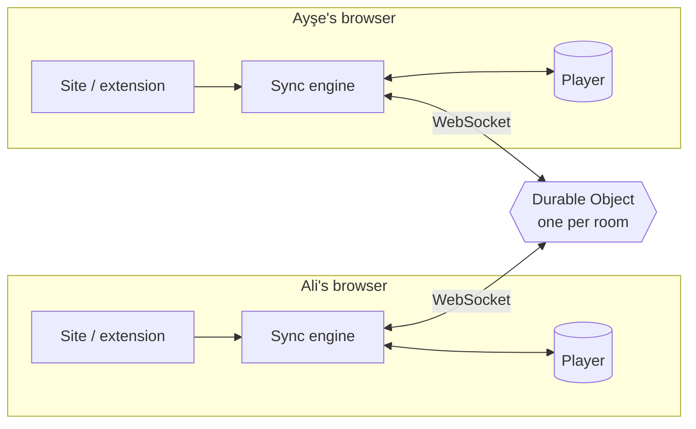

<div align="center">

# ▶ ScreenWithMe

**Watch any video together, in perfect sync.**<br/>
Free · no accounts · no ads · works on YouTube and on (almost) any website.

[**Live site**](https://screen-with-me.swm-server.workers.dev) ·
[**Get the extension**](https://screen-with-me.swm-server.workers.dev/eklenti.html) ·
[Roadmap](docs/VIZYON.md) ·
[🇹🇷 Türkçe](#-türkçe)


</div>

---

Send a link, and everyone watches the same second. If anyone pauses, seeks or changes
the speed, it happens for everyone. Reactions, chat, pins and a shared queue sit around the video.

- **YouTube or a video file** → plays right on the site, nothing to install.
- **Any other site** (the page has an HTML5 `<video>`, even inside an iframe) → with the browser
  extension the page opens **inside the room** when the site allows it, otherwise in its own tab,
  where the extension turns the page into a **room view** (video + chat panel).

## ✨ Features

### Watching together
| | |
|---|---|
| ⏯️ **Tight sync** | Play / pause / seek / speed for everyone. Server-time based, measured **30–100 ms** apart on real players. Drift is corrected silently (small drift by playing ±5 % faster/slower). |
| ⏳ **Everyone ready** | If someone's video stalls (buffering, an ad), the room waits for them — at most 12 s; the same person can't stall the room again for 30 s. |
| 🧩 **Any website** | The extension finds the right video (skips ads and short previews), also inside iframes and in players that load late or switch sources. |
| 🪟 **Film inside the room** | With the extension, a page link opens in the room's player area showing only the video. Pages that forbid being framed (checked from their headers, never stripped) fall back to their own tab. |
| 🖼️ **Room view** | When the video plays in its own tab, the extension turns that page into the same room as on the website: top bar, invite + chat + people on the right, reactions, pins, sync and speed under the video, all in the Night theme. Works on sites that forbid framing too. Before the video exists, a "Start the film" card points at the player. Fullscreen keeps the controls and a draggable message spot. |
| ⏩ **Shared speed** | 0.25×–4× (YouTube up to 2×), fine steps of ±0.05. In the extension other speed extensions can't knock the room out of sync. |
| 🧪 **Sync test** | A built-in 12-second counter drawn by the site; a badge shows how far apart you are. |
| 🖥️ **Fullscreen** | Distraction-free: controls, reactions, pins and a quick-message box appear when you move the mouse. |

### Room life
| | |
|---|---|
| 🔗 **One link, no accounts** | Name + avatar once (drawn themed characters, animals, film / series / anime parodies), remembered by the browser. |
| 🎵 **Queue & voting** | Add, reorder, play now; 👍 votes reorder the queue. Auto-next can be turned off ("Start next" card instead). |
| 💬 **Chat & reactions** | Tabbed side panel (chat, queue, people, settings). Three emoji pages; reactions show bottom-left as an avatar + name card. Room activity in chat is hidden by default ("Show actions"). |
| 🖼️ **Custom emojis** | Add your own image or GIF; the whole room can react with it (up to 24 per room). |
| 📌 **Pins** | Pin a moment with an optional note; a strip under the video jumps back to it. |
| ⌨️ **Shortcuts** | 1–8 reactions, Enter chat, P pin (the extension swallows these keys so the page's player doesn't seek). |
| 💾 **Saved rooms** | Create a one-off room or a named saved room (kept 30 days). Saved rooms remember where each video stopped and its pins; your list on the home page shows how many people are inside. |
| 📊 **Session recap** | A Spotify-Wrapped-style recap of the session (time watched, videos, most talkative, favourite emoji…) with a downloadable image; past recaps are kept. |
| ⏰ **Scheduled start** | Pick a time; a countdown banner shows and the room starts by itself. |

### Host & safety
| | |
|---|---|
| 👑 **Room host** | The first person in is the host (survives reloads). Gone for more than 20 s → hosting passes to the longest-present member for good. |
| 🔒 **Host modes** | Only the host controls playback · lock the queue · turn off emojis · ready check on/off. |
| 🚪 **Remove & ban** | The host removes people; they stay out until the host lifts the ban. |
| 🔐 **Private by design** | Video plays in each person's own browser; the server only relays tiny "pause at 12:34" messages and the room's chat. The extension is dormant outside a room. User text is never written as HTML. |

### Look & feel
| | |
|---|---|
| 🎨 **12 themes** | Night, Ocean, Sunset, Neon, plus illustrated Fantasy medieval, Turkish Delight, Arabian Nights and Art Deco poster themes (Picture Palace, Opera Night, Drive-In, Ocean Liner, Night Express), each with the mascot in costume. |
| 🎬 **Intro** | A short logo animation with a generated sound (Web Audio, no files). |
| 🌍 **Languages** | Turkish (default) and English, on the site and in the extension. |

## 🧠 How it works



- **The server is the single source of truth.** A room's state is just
  `{ item, paused, position, rate, updatedAt }`; the current position is
  `position + (serverNow − updatedAt) × rate`. Messages are only sent when someone *does* something.
- **Clock sync.** Clients estimate server time with a few ping/pongs (a mini NTP) and do all math in server time.
- **"Was that the user or me?"** When the engine commands the player it records which event it expects
  (e.g. one `pause`). Expected events are ignored for a moment; anything unexpected is a user action.
  This prevents echo loops without swallowing a real pause.
- **Seeks** are detected from unexpected jumps in time (YouTube has no seek event).
- **Drift** above 1 s jumps back into place; smaller drift is closed by playing ±5 % faster/slower.
- **One Durable Object per room** — rooms scale independently; with WebSocket Hibernation an idle room costs
  nothing. Timers that must survive sleep (ready-check timeout, scheduled start, room deletion) use one storage alarm.

### Extension in one paragraph
A Manifest V3 extension. The background service worker keeps one room connection per tab. A content
script runs in every frame (top page and iframes) but does nothing unless the user is in a room; then
each frame reports its best video candidate (size, duration, playing) and the background picks the
winner, where the same sync engine as the site runs. A page link opened in a room is first tried inside
the site (an iframe in the player area; the site keeps the room connection and the extension only runs the
engine in that frame and relays playback messages). If the page can't be framed, the site hands the tab
over to the extension, which takes it to that page and switches on the room view.

## 🧪 Quality

| Check | Result |
|---|---|
| Unit tests (sync engine with fake clock & player, protocol validation, room rules, ready check, recap, embedding rules) | 126 passing |
| End-to-end (fake users against the real server code: queue, chat, host & kick, handover, ready check, pins, custom emojis, host modes, saved rooms, recap) | `npm run e2e`, runs in CI |
| Real players (extension code injected into public demo pages) | **Plyr, hls.js, Video.js**: detection ✓, 4 remote + 4 local actions ✓, 26–100 ms apart |
| Tricky pages (test harness) | iframe player, player loaded after join, source switch, pages that forbid framing ✓ |

## 🛠️ Tech

TypeScript (strict) everywhere, no front-end framework · Vite · Cloudflare Workers + Durable Objects
(SQLite-backed, WebSocket Hibernation) · Chrome Manifest V3 + esbuild · Vitest · GitHub Actions.

```
packages/shared   protocol + validation, room rules, sync engine, clock, connection, media parsing,
                  ready check, recap, embedding rules, logo
apps/server       Worker + Durable Object (one per room)
apps/web          the site (plain TS/HTML/CSS)
apps/extension    browser extension (background, content script, overlay, popup, site bridge)
scripts/          end-to-end tests, extension test harnesses, icon / theme art / avatar generators
store/            Chrome Web Store package and screenshots
docs/             vision & roadmap, growth plan, store guide
```

## 🚀 Development

Requires Node.js 20+ (CI uses 24).

```bash
npm install
npm run dev          # server on :8787 + site on :5173 (proxies /api)
npm test             # unit tests
npm run typecheck
npm run e2e          # end-to-end against the local server
```

Extension: `npm run build:extension:dev`, then `chrome://extensions` → Developer mode →
**Load unpacked** → `apps/extension/dist`.

Deploy: every push to `main` is tested and then deployed by GitHub Actions (needs the
`CLOUDFLARE_API_TOKEN` and `CLOUDFLARE_ACCOUNT_ID` repository secrets), followed by the end-to-end
tests against the live server. It can also be run by hand from the Actions tab. Locally:
`npx wrangler login` once, then `npm run deploy`.

## 🗺️ Roadmap

Next up: Chrome Web Store release, manual video picker, short domain, demo video,
push-to-talk voice chat, Firefox. Full list: [docs/VIZYON.md](docs/VIZYON.md).

## 📄 License & privacy

[MIT](LICENSE) © 2026 Alperen Aktürk. All shipped code (site, server, extension) is our own; build tools are
MIT / Apache-2.0. Privacy policy: [gizlilik.html](https://screen-with-me.swm-server.workers.dev/gizlilik.html)
— no accounts, no tracking; a one-off room is deleted 24 h after it is empty, a saved room after 30 days.

## ⚠️ Limitations

- DRM-protected services (Netflix, Disney+…) are not a goal.
- The extension is not in the Chrome Web Store yet (manual install, ~1 minute).
- Firefox is not supported yet. Pages from other sites need a desktop browser with the extension.
- If the `<video>` element itself goes fullscreen, the extension overlay can't show (player-container fullscreen works).
- ScreenWithMe never hosts or relays video content; it only synchronises players that each person opens themselves.

---

## 🇹🇷 Türkçe

**ScreenWithMe**, arkadaşlarınla aynı videoyu aynı anda izlemek için ücretsiz, hesapsız ve reklamsız
bir araç. Link at, herkes aynı saniyede izlesin; biri durdurursa herkes dursun.

- **YouTube ya da video dosyası:** doğrudan sitede, kurulum yok.
- **Başka bir site:** eklenti sayfadaki videoyu bulur (iframe içindekiler dahil). Site izin veriyorsa film
  odanın içinde açılır (sadece video); izin vermiyorsa kendi sekmesinde açılır ve eklenti o sayfayı
  **oda görünümüne** çevirir (üstte şerit, yanda sohbet / emoji / hız).

Özellikler:
- Sıkı senkron (30–100 ms), "herkes hazır" beklemesi, 4x'e kadar ortak hız, senkron testi
- Sıra, oylama, otomatik devam (kapatılabilir)
- Sohbet, emojiler, özel emojiler (kendi GIF / resmin), önemli anları pinleme
- Klavye kısayolları: 1–8 emoji, Enter mesaj, P pin
- Kaydedilen odalar (30 gün; videoların kaldığı yer ve pinler hatırlanır), planlı başlangıç
- Oturum özeti (Spotify özeti gibi, indirilebilir görsel)
- Oda yöneticisi (👑): odadan çıkarma ve yasak kaldırma, sadece yönetici kontrolü, sıra kilidi, emojileri kapatma
- İsim ve çizilmiş avatarlar, 12 tema (resimli ve Art Deco temalar, kostümlü maskot)
- Dikkat dağıtmayan tam ekran, "Herkesi bana eşitle", Türkçe / İngilizce arayüz

Bağlantılar:
- **Canlı site:** https://screen-with-me.swm-server.workers.dev
- **Eklenti kurulumu:** https://screen-with-me.swm-server.workers.dev/eklenti.html
- **Vizyon ve yol haritası:** [docs/VIZYON.md](docs/VIZYON.md)
