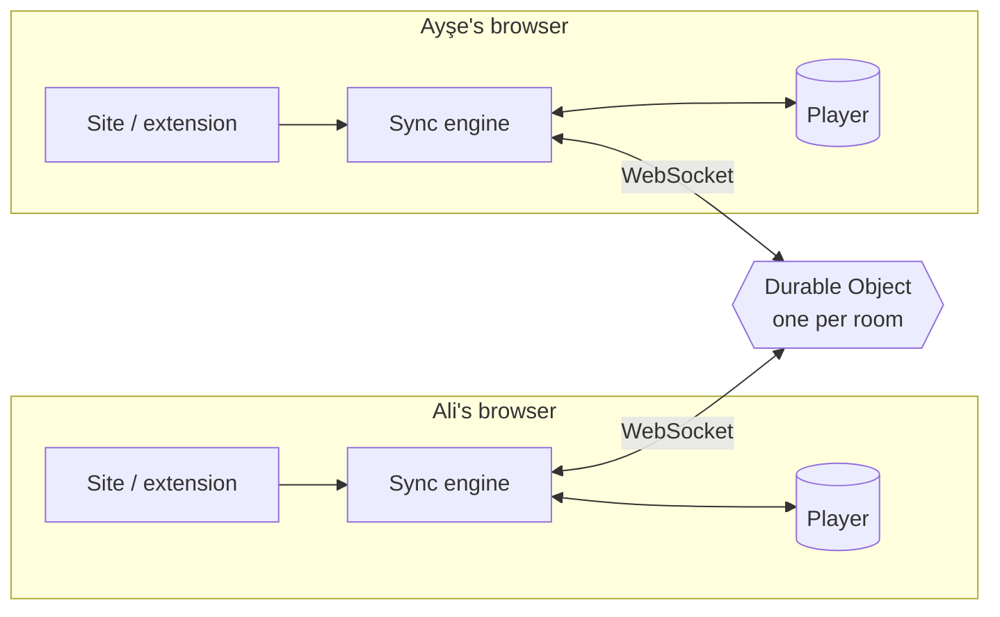

<div align="center">

# ▶ ScreenWithMe

**Watch any video together, in perfect sync.**<br/>
Free · no accounts · no ads · works on YouTube and on (almost) any website.

[**Live site**](https://screen-with-me.swm-server.workers.dev) ·
[**Get the extension**](https://screen-with-me.swm-server.workers.dev/eklenti.html) ·
[🇹🇷 Türkçe](README.tr.md)


</div>

---

Send a link, and everyone watches the same second. If anyone pauses, seeks or changes the speed, it happens
for everyone. Chat, reactions, pins and a shared queue sit around the video.

- **YouTube or a video file** → plays right on the site, nothing to install.
- **Any other site** (the page has an HTML5 `<video>`, even inside an iframe) → the tab goes to that site and,
  with the browser extension, the **room itself** (exactly the site's room page) opens over it, with the video
  sitting in the room's player area. Works on sites that forbid being framed, too.

## ✨ Features

### Watching together
| | |
|---|---|
| ⏯️ **Tight sync** | Play / pause / seek / speed for everyone. Server-time based, measured **30–100 ms** apart on real players. Small drift is closed silently by playing ±5 % faster or slower. |
| ⏳ **Everyone ready** | If someone's video stalls, the room waits for them (at most 12 s; the same person can't stall it again for 30 s). Off when you are alone. |
| 🧩 **Any website** | The extension finds the right video, also inside iframes and in players that load late or switch sources. Short videos, looping muted videos and small pinned corner videos (typical ads) are skipped, and an ad playing in the film's own player is never synced to the room. Wrong video? **🎯 Pick video** puts a "Sync this one" button on every video of the page. |
| 🛡️ **Ad-proof room** | A tab the video page opens to another site right after you click it (a typical ad pop-up) is closed and the film stays in front ("Reopen" if you meant it; can be turned off). If the page redirects you elsewhere, the room stays and offers **↩ Back to the film**. While someone watches an ad, the room doesn't wait for them; they show as "in an ad" and catch up afterwards. |
| 🖼️ **Room over the film page** | The site's own room page opens as a layer over the film page, with a hole where the video goes. It appears right away (before the video starts) and nothing of the page flashes while it loads. Messages and emojis over the video are see-through, like on the site. **👁 Show page** steps the room aside for a moment to close a pop-up or ad covering the video. |
| 🖥️ **Fullscreen** | Distraction-free: controls, reactions and a quick-message box appear when you move the mouse and hide again. On film pages you can choose whether the video fills the screen or stays above the controls (subtitles never covered). |
| ⏩ **Shared speed** | 0.25×–4× (YouTube up to 2×), fine steps of ±0.05. Other speed extensions can't knock the room out of sync. |
| 🧪 **Sync test** | A built-in 12-second counter drawn by the site; a badge shows how far apart you are. |

### Room life
| | |
|---|---|
| 🔗 **One link, no accounts** | Name + avatar once (drawn themed characters and film / series / anime / game parodies), remembered by the browser. The 👤 menu (top right) holds name, avatar, theme and the session recap. |
| 📱 **Shorts view** | Open a YouTube Shorts link and the room turns vertical: the video in the middle, friends sitting on both sides. Messages pop up as bubbles from the sender's avatar, reactions rise from it. ↑ / ↓ (or ▲▼, mouse wheel) go to the previous / next short for everyone; 🔁 loop replays a finished short. Queue, chat history and settings stay one click away in the room view. |
| 🎵 **Queue & voting** | Add, reorder, play now; 👍 votes reorder the queue. Auto-next can be turned off ("Start next" card instead). |
| 🎙 **Voice & video chat** | "Join voice" in the room: talk while you watch, mute with one click, the speaker's avatar glows and a small bar under 🎙 shows that your microphone hears you. 📷 turns on a small camera: friends' cameras appear in the voice card and, in fullscreen, in the corner of the video (on film pages too; the camera is asked once for ScreenWithMe). Peer-to-peer and always encrypted (the server never hears it), up to 6 people; nobody hears you unless they joined voice too. Works on film pages too: the microphone is asked once for ScreenWithMe (not for the film site), voice keeps going when the film page reloads, and the film gets quieter while someone talks. |
| 📺 **Screen sharing** | Show your screen, a window, a tab or your camera to the room (games, photos, "look at this", not for films). One stream per room, up to 4 viewers who choose to watch, 720p, peer-to-peer. It opens in a corner of the video and can be enlarged. The limits are always shown ("Watching 3/4"). |
| 💬 **Chat & reactions** | Chat, queue, people and settings tabs. Three emoji pages; reactions float up from the bottom of the video with the sender's avatar and name, as fast as you like. Anyone can hide them for themselves. Room activity in chat is hidden by default. |
| 🖼️ **Custom emojis** | Add your own image or GIF; the whole room can react with it (up to 24 per room). |
| 📌 **Pins** | Pin a moment with an optional note; a strip under the video jumps back to it. |
| ⌨️ **Shortcuts** | 1–8 reactions, Enter chat, P pin (on film pages these keys never reach the page's player). |
| 💾 **Saved rooms** | Create a one-off room or a named saved room (kept 30 days). Saved rooms remember where each video stopped and its pins; your list on the home page shows how many people are inside. |
| 📊 **Session recap** | A Spotify-Wrapped-style recap of the session (time watched, videos, most talkative, favourite emoji…) with a downloadable image; past recaps are kept. |
| ⏰ **Scheduled start** | Pick a time; a countdown banner shows and the room starts by itself. |
| 🎮 **PlayWithMe** | A small game corner (🎮 in the top menu): tic-tac-toe for two, by link; anyone else who opens the link watches, cheers with emojis and can take a free seat. More games to come. |
| 🏠 **Back to the room** | When someone leaves the film page for the room, the others get a small "go back too?" card. |

### Host & safety
| | |
|---|---|
| 👑 **Room host** | The first person in is the host (survives reloads) and starts on the settings tab. Gone for more than 20 s → hosting passes to the longest-present member for good. |
| 🔒 **Host modes** | Only the host controls playback · lock the queue · turn off emojis or limit how often each person can send one · ready check on/off. |
| 🚪 **Remove & ban** | The host removes people; they stay out until the host lifts the ban. |
| 🔐 **Private by design** | Video plays in each person's own browser; the server only relays tiny "pause at 12:34" messages and the room's chat. The extension is dormant outside a room, and the film page can't read which room you are in. User text is never written as HTML. Rate limits live on the server. |

### Look & feel
| | |
|---|---|
| 🎨 **11 themes** | Night, Ocean, Sunset, Neon, plus illustrated Turkish Delight, Arabian Nights and Art Deco poster themes (Picture Palace, Opera Night, Drive-In, Ocean Liner, Night Express), each with the mascot in costume. |
| 🎬 **Intro** | A short logo animation with a generated sound (Web Audio, no files). |
| 🌍 **Languages** | Turkish (default) and English, on the site and in the extension. |

## 🧠 How it works



- **The server is the single source of truth.** A room's state is just `{ item, paused, position, rate, updatedAt }`;
  the current position is `position + (serverNow − updatedAt) × rate`. Messages are only sent when someone *does* something.
- **Clock sync.** Clients estimate server time with a few ping/pongs (a mini NTP) and do all math in server time.
- **"Was that the user or me?"** When the engine commands the player it records which event it expects
  (e.g. one `pause`). Expected events are ignored for a moment; anything unexpected is a user action.
  This prevents echo loops without swallowing a real pause.
- **Seeks** are detected from unexpected jumps in time (YouTube has no seek event).
- **Drift** above 1 s jumps back into place; smaller drift is closed by playing ±5 % faster/slower.
- **One Durable Object per room**: rooms scale independently; with WebSocket Hibernation an idle room costs
  nothing. Timers that must survive sleep (ready-check timeout, scheduled start, room deletion) use one storage alarm.

### Extension in one paragraph
A Manifest V3 extension with no UI and no room connection of its own. When a page is opened in a room, the site
sends the tab there; on the film page the extension opens `shell.html` as a full-screen layer, which asks the
background for the room and loads the site's room page (`/r/ROOM?shell=1`). The site keeps the room connection;
the extension only relays: a content script in every frame reports its best video, the background picks the
winner and the same sync engine as the site runs there, playback messages go to the site, room state comes back.
The site reports where its player area is; the top frame clips a hole there (`clip-path`) and moves the film's
player into it.

## 🧪 Quality

| Check | Result |
|---|---|
| Unit tests (sync engine with fake clock & player, protocol validation, room rules, ready check, recap, video scoring) | 140 passing |
| End-to-end (fake users against the real server code: queue, chat, host & kick, handover, ready check, pins, custom emojis, host modes, emoji rate, saved rooms, recap, Shorts) | `npm run e2e`, runs in CI |
| Real Chrome with the extension (`scripts/harness/embed`) | 90 checks: room layer, hole placement, no page flash (screen recording), see-through messages (pixel sampling), fullscreen subtitles and controls, pins, settings sync between site and extension, video picker, ad tabs, redirects, pre-roll ads |
| Real voice (`scripts/harness/voice`) | Two Chromes with fake microphones: the received audio's energy is measured, on the site and on film pages (extension), incl. the permission tab and reloads |
| Real players (extension code on public demo pages) | **Plyr, hls.js, Video.js**: detection ✓, remote + local actions ✓, 26–100 ms apart |

## 🛠️ Tech

TypeScript (strict) everywhere, no front-end framework · Vite · Cloudflare Workers + Durable Objects
(SQLite-backed, WebSocket Hibernation) · Chrome Manifest V3 + esbuild · Vitest · GitHub Actions.

```
packages/shared   protocol + validation, room rules, sync engine, clock, connection, media parsing,
                  ready check, recap, video scoring, logo
apps/server       Worker + Durable Object (one per room)
apps/web          the site (plain TS/HTML/CSS)
apps/extension    browser extension (background, content script, room layer "shell", site bridge, popup)
scripts/          end-to-end tests, real-Chrome extension harness, icon / theme art / avatar generators
store/            Chrome Web Store package and screenshots
```

## 🚀 Development

Requires Node.js 20+ (CI uses 24).

```bash
npm install
npm run dev          # server on :8787 + site on :5173 (proxies /api)
npm test             # unit tests
npm run typecheck
npm run e2e          # end-to-end against the local server
```

Extension: `npm run build:extension:dev`, then `chrome://extensions` → Developer mode → **Load unpacked** →
`apps/extension/dist`.

Deploy: every push to `main` is tested and then deployed by GitHub Actions (needs the `CLOUDFLARE_API_TOKEN` and
`CLOUDFLARE_ACCOUNT_ID` repository secrets), followed by the end-to-end tests against the live server.
Locally: `npx wrangler login` once, then `npm run deploy`.

## 🗺️ What's next

Chrome Web Store release, more games, a short domain, push-to-talk voice chat, Firefox.

## 📄 License & privacy

[MIT](LICENSE) © 2026 Alperen Aktürk. All shipped code (site, server, extension) is our own; build tools are
MIT / Apache-2.0. Privacy policy: [privacy.html](https://screen-with-me.swm-server.workers.dev/privacy.html?lang=en)
(no accounts, no tracking; a one-off room is deleted 24 h after it is empty, a saved room after 30 days).

## ⚠️ Limitations

- DRM-protected services (Netflix, Disney+…) are not supported yet.
- The extension is not in the Chrome Web Store yet (manual install, about a minute).
- Firefox is not supported yet. Pages from other sites need a desktop browser with the extension.
- ScreenWithMe never hosts or relays video content; it only synchronises players that each person opens themselves.
