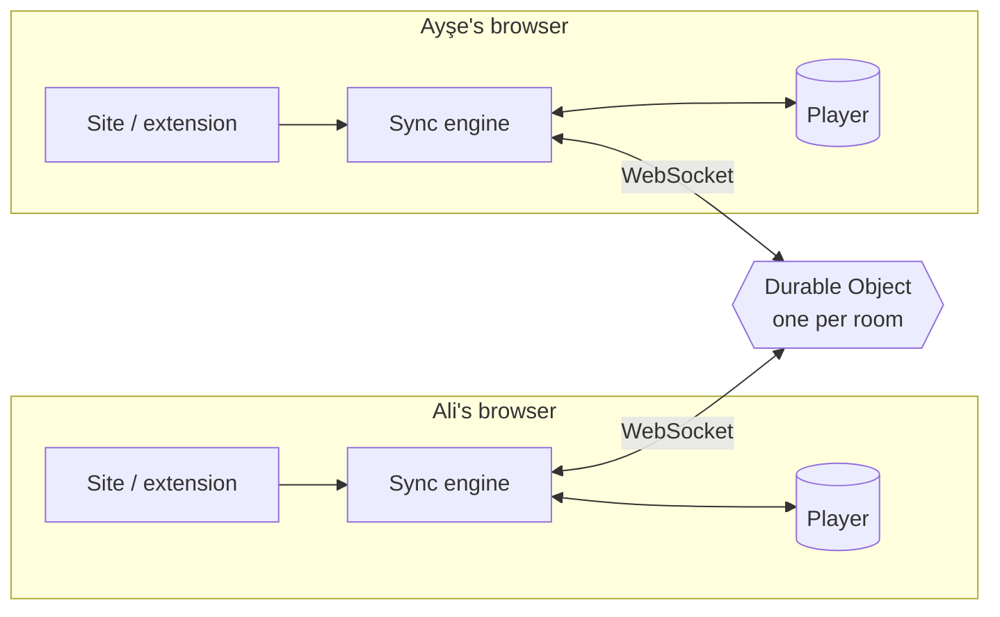

<div align="center">

# ▶ ScreenWithMe

**Watch any video together, in perfect sync.**<br/>
Free · no accounts · open source · works on YouTube and on (almost) any website.

[**Live site**](https://screen-with-me.swm-server.workers.dev) ·
[**Get the extension**](https://screen-with-me.swm-server.workers.dev/eklenti.html) ·
[Roadmap](docs/VIZYON.md) ·
[🇹🇷 Türkçe](#-türkçe)


</div>

---

Send a link, and everyone watches the same second. If anyone pauses, seeks or changes
the speed, it happens for everyone. Reactions fly over the video, chat runs on the side,
and there is a shared queue.

- **YouTube or a video file** → plays right on the site, nothing to install.
- **Any other site** (the page has an HTML5 `<video>`, even inside an iframe) → the browser
  extension finds the video on the page and keeps everyone in sync.

## ✨ Features

| | |
|---|---|
| ⏯️ **Tight sync** | Play / pause / seek / speed for everyone. Server-time based, measured **30–100 ms** apart on real players. Drift is corrected silently. |
| 🔗 **One link, no accounts** | Create a room, share the link. Pick a name and an avatar once (themed characters, animals, or film / series / anime parody characters) — remembered by the browser. |
| 🧩 **Any website** | The extension finds the right video (skips ads and previews), also inside iframes and in players that load late or switch sources. |
| 🎵 **Queue** | Add, reorder, play now; the next video starts automatically for everyone. |
| 💬 **Chat & reactions** | Tabbed side panel (chat with room activity, queue, people, settings). Three pages of emoji reactions (▲▼) fly over the video, also in fullscreen. A short Enjoy the show! intro when you enter. |
| 👑 **Room host** | The first person in is the host (survives page reloads) and can remove people until they lift the ban. If the host is gone for more than 20 s, hosting passes to the longest-present member for good. |
| ⏳ **Ready check** | If someone's video stalls (buffering, an ad), the room waits for them — at most 12 s, and the same person can't stall the room again for 30 s, so one slow connection can't ruin the night. |
| 🖥️ **Distraction-free fullscreen** | Only the video; controls, reactions and a quick-message box appear when you move the mouse. |
| 🎨 **15 dark themes** | Night, Ocean, Sunset, Neon, plus illustrated Space, Cyberpunk, Fantasy medieval, Turkish Delight, Arabian Nights and Art Deco poster themes (Picture Palace, Opera Night, Drive-In, Ocean Liner, Night Express, City Express), each with the mascot in costume. TR / EN interface. |
| 🔒 **Private by design** | Video plays in each person's own browser. The server only relays tiny "pause at 12:34" messages. The extension stays idle outside of a room. |

## 🧠 How it works



- **The server is the single source of truth.** A room's state is just
  `{ item, paused, position, rate, updatedAt }`; the current position is
  `position + (serverNow − updatedAt) × rate`. Messages are only sent when someone *does* something.
- **Clock sync.** Clients estimate server time with a few ping/pongs (a mini NTP) and do all math in server time.
- **"Was that the user or me?"** When the engine commands the player it records which event it expects
  (e.g. one `pause`). Expected events are ignored for a moment; anything unexpected is a user action.
  This prevents echo loops without swallowing a real pause.
- **Seeks** are detected from unexpected jumps in time (YouTube has no seek event).
- **Drift** above 1 s jumps back into place; smaller drift is closed by playing ±5 % faster/slower.
- **One Durable Object per room** — rooms scale independently; with WebSocket Hibernation an idle room costs nothing.

### Extension in one paragraph
A Manifest V3 extension. The background service worker keeps one room connection per tab. A content
script runs in every frame (top page and iframes) but does nothing unless the user is in a room; then
each frame reports its best video candidate (size, duration, playing) and the background picks the
winner, where the same sync engine as the site runs. When a web-page link is opened in a room, the site
hands the tab over to the extension, which takes it to that page; switching back to YouTube returns the tab to the site.

## 🧪 Quality

| Check | Result |
|---|---|
| Unit tests (sync engine with fake clock & player, protocol validation, room rules, ready check) | 100 passing |
| End-to-end (fake users against the real server: queue, chat, reactions, host & kick, page items, ready check) | `npm run e2e` |
| Real players (extension code injected into public demo pages) | **Plyr, hls.js, Video.js**: detection ✓, 4 remote + 4 local actions ✓, 26–100 ms apart |
| Tricky pages (test harness) | iframe player, player loaded after join, source switch ✓ |

## 🛠️ Tech

TypeScript (strict) everywhere, no front-end framework · Vite · Cloudflare Workers + Durable Objects
(SQLite-backed, WebSocket Hibernation) · Chrome Manifest V3 + esbuild · Vitest.

```
packages/shared   protocol + validation, room rules, sync engine, clock, connection, media parsing
apps/server       Worker + Durable Object (one per room)
apps/web          the site (plain TS/HTML/CSS)
apps/extension    browser extension (background, content script, overlay, popup)
scripts/          end-to-end tests and an extension test harness
docs/             vision & roadmap, competitor analysis
```

## 🚀 Development

Requires Node.js 20+.

```bash
npm install
npm run dev          # server on :8787 + site on :5173 (proxies /api)
npm test             # unit tests
npm run typecheck
npm run e2e          # end-to-end against the local server
```

Extension: `npm run build:extension:dev`, then `chrome://extensions` → Developer mode →
**Load unpacked** → `apps/extension/dist`.

Deploy: `npx wrangler login` once, then `npm run deploy` (tests, builds the extension zip and the site,
uploads one Worker that serves both the API and the static site).

## 🗺️ Roadmap

Next up: Chrome Web Store & Firefox releases, manual video picker, host-only control mode,
push-to-talk voice chat. Full list: [docs/VIZYON.md](docs/VIZYON.md).

## 📄 License & privacy

[MIT](LICENSE) © 2026 Alperen Aktürk. All shipped code (site, server, extension) is our own; build tools are
MIT / Apache-2.0. Privacy policy: [gizlilik.html](https://screen-with-me.swm-server.workers.dev/gizlilik.html)
— no accounts, no tracking, room data deleted 24 h after a room is empty.

## ⚠️ Limitations

- DRM-protected services (Netflix, Disney+…) are not a goal.
- The extension is not in the Chrome Web Store yet (manual install, ~1 minute).
- Firefox is not supported yet.
- ScreenWithMe never hosts or relays video content; it only synchronises players that each person opens themselves.

---

## 🇹🇷 Türkçe

**ScreenWithMe**, arkadaşlarınla aynı videoyu aynı anda izlemek için ücretsiz, hesapsız ve açık
kaynak bir araç. Link at, herkes aynı saniyede izlesin; biri durdurursa herkes dursun.

- **YouTube ya da video dosyası:** doğrudan sitede, kurulum yok.
- **Başka bir site:** eklenti sayfadaki videoyu bulur (iframe içindekiler dahil) ve herkesi senkronda tutar.

Özellikler:
- Sıra (playlist)
- Sekmeli panel: sohbet, sıra, kişiler, ayarlar
- Uçan emojiler
- Oda yöneticisi (👑) ve kişileri odadan çıkarma
- İsim ve avatar
- 5 koyu tema
- Dikkat dağıtmayan tam ekran
- "Herkesi bana eşitle"

Bağlantılar:
- **Canlı site:** https://screen-with-me.swm-server.workers.dev
- **Eklenti kurulumu:** https://screen-with-me.swm-server.workers.dev/eklenti.html
- **Vizyon ve yol haritası:** [docs/VIZYON.md](docs/VIZYON.md)
