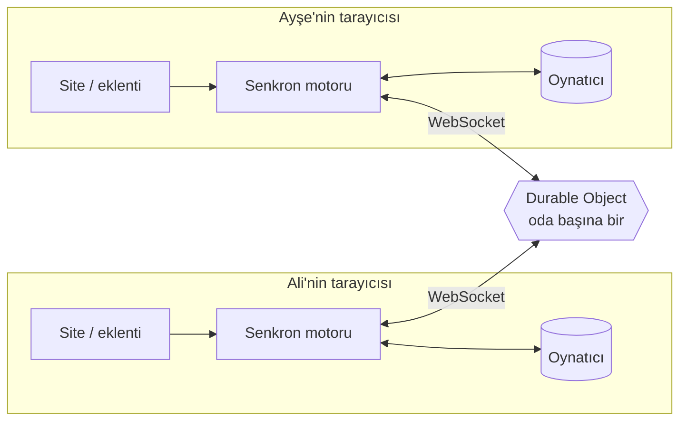

<div align="center">

# ▶ ScreenWithMe

**Herhangi bir videoyu birlikte, tam senkron izle.**<br/>
Ücretsiz · hesap yok · reklam yok · YouTube'da ve (neredeyse) her sitede çalışır.

[**Canlı site**](https://screen-with-me.swm-server.workers.dev) ·
[**Eklentiyi kur**](https://screen-with-me.swm-server.workers.dev/eklenti.html) ·
[🇬🇧 English](README.md)


</div>

---

Link at, herkes aynı saniyeyi izlesin. Biri durdurur, sarar ya da hızı değiştirirse herkeste olur. Sohbet,
emojiler, pinler ve ortak sıra videonun etrafında.

- **YouTube ya da video dosyası** → doğrudan sitede oynar, kurulum yok. Linkin yoksa aynı kutuya kelime yazıp YouTube'da ara.
- **Başka herhangi bir site** (sayfada HTML5 `<video>` varsa, iframe içinde bile) → sekme o siteye gider ve
  tarayıcı eklentisiyle **odanın kendisi** (sitenin oda sayfasının aynısı) üstüne açılır, video odanın
  oynatıcı alanına oturur. Gömülmeyi yasaklayan sitelerde de çalışır.

## ✨ Özellikler

### Birlikte izleme
| | |
|---|---|
| ⏯️ **Sıkı senkron** | Oynat / durdur / sar / hız herkeste. Sunucu saatine dayanır, gerçek oynatıcılarda **30–100 ms** fark ölçüldü. Küçük kaymalar sessizce ±%5 hızlı/yavaş oynatarak kapanır. |
| ⏳ **Herkes hazır** | Birinin videosu takılırsa oda onu bekler (en fazla 12 sn; aynı kişi 30 sn tekrar bekletemez). Odada tek başınayken kapalı. |
| 🧩 **Her site** | Eklenti doğru videoyu bulur, iframe içinde ve geç yüklenen ya da kaynağı değişen oynatıcılarda da. Kısa videolar, döngüde sessiz videolar ve köşeye sabitlenmiş küçük videolar (tipik reklamlar) atlanır; filmin kendi oynatıcısında oynayan reklam odaya asla yansımaz. Yanlış video mu? **🎯 Video seç** sayfadaki her videonun üstüne "Bunu senkronla" düğmesi koyar. |
| 🛡️ **Reklama dayanıklı oda** | Video sayfasına tıklayınca başka siteye açılan sekme (tipik reklam penceresi) kapatılır, film önde kalır (bilerek açtıysan "Geri aç"; kapatılabilir). Sayfa seni başka bir siteye götürürse oda kalır ve **↩ Filme geri dön** der. Biri reklam izlerken oda onu beklemez; "reklamda" görünür, reklam bitince yetişir. |
| 🖼️ **Film sayfasının üstünde oda** | Sitenin oda sayfası film sayfasının üstüne katman olarak açılır, videonun yerinde bir delik bırakır. Hemen gelir (video başlamadan) ve yüklenirken sayfadan hiçbir şey görünmez. Video üstündeki mesajlar ve emojiler sitedeki gibi saydam. **👁 Sayfayı göster** odayı bir anlığına kenara çeker: videonun önünü kapatan pencere ya da reklam kapatılır. |
| 🖥️ **Oynatıcı düğmeleri ve tam ekran** | YouTube, video dosyaları ve film sayfaları kendi oynatıcı çubuğunu korur; hiçbir özellik kaybolmaz (kalite, altyazı dili, bölümler) ve film hiç küçülmez. Bizim düğmelerimiz pencerede de tam ekranda da videonun sağ kenarında ince bir dock'tadır: mesaj, emojiler, pin, mikrofon, kamera, ekran paylaşımı, hız, sonraki ve tam ekran; her birinin adı ve kısayolu vardır. Dock, oynatıcının kendi çubuğuyla birlikte görünür ve gizlenir (fareyi oynatınca ve video dururken görünür); tam ekranda mesajlar hemen yanından akar, odanın sorduğu her şey (sese katılma gibi) tam ekranın içinde görünür. Shorts'ta da YouTube'un kendi çubuğu var (YouTube'un kuralı: oynatıcısının üstüne bizden bir şey konmaz). |
| ⏩ **Ortak hız** | 0,25×–4× (YouTube en fazla 2×), ±0,05 ince ayar. Başka hız eklentileri odanın senkronunu bozamaz. |
| 🧪 **Senkron testi** | Sitenin çizdiği 12 saniyelik sayaç; rozet aranızdaki farkı gösterir. |

### Oda
| | |
|---|---|
| 🔗 **Tek link, hesap yok** | Davet linki tek kısa ekran açar: seni kimin beklediği ve ne oynadığı, adın ve yanında avatarın (çizilmiş temalı karakterler ve film / dizi / anime / oyun parodileri), tek düğmeyle içeri. İlk seferde üç küçük ipucu davet etmeyi, video eklemeyi ve sese katılmayı gösterir. Film sayfası eklenti isterse kart, eklenti kurulduğu an bunu fark eder. Sağ üstteki 👤 menüsünde ad, avatar, tema ve oturum özeti. |
| 📱 **Shorts görünümü** | YouTube Shorts linki (ya da TikTok linki: TikTok'un resmi oynatıcısında oynar) açılınca oda dikey olur: video ortada, arkadaşlar iki yanında oturur. Mesajlar yazanın avatarından baloncuk olarak çıkar, emojiler oradan yükselir (videonun üstünde uçmaz); bir arkadaşın kamerası doğrudan profil yuvarlağının içinde görünür (altta baştan 🎙 ve 📷 var, burada kamera pencereleri yok). Alt çubukta odadakiyle aynı 😀 Tepki tepsisi (özel emojiler dahil, son kullandığın üçü yanında) ve görünümden çıkmadan sıraya link eklemek ya da kelime yazıp sadece YouTube Shorts aramak ve tek dokunuşla eklemek için küçük bir ＋ Ekle kutusu var. Oradaki 🎮 oyunu videonun yanında serbest pencerede açar (açık bir oyun da kendiliğinden oraya geçer); yeni bir ♾ akış başlatınca eski akışın Shorts'ları sıradan çıkar. Oda görünümünde bir Short da diğer videolardaki dock'u kullanır. ↑ / ↓ (ya da ▲▼, fare tekerleği ya da videonun yanında parmakla kaydırma) herkes için önceki / sonraki Shorts; ♾ **Shorts akışı**: bir konu seç (ya da bir aramada "📱 Shorts akışı"na bas), sıra azaldıkça o konudan yeni Shorts kendiliğinden eklenir; **🎲 Keşfet** hiç konu istemez (Popüler, Müzik, Oyun, Komedi, Hayvanlar, Spor: son iki haftanın en çok izlenen Shorts'ları, her odada farklı sırayla) ve **✨ Bunun gibi** oynayan Short'un kanalından, sonra benzer başlıklardan yenilerini getirir; 🔁 döngü biten Shorts'u yeniden oynatır. Sıra, sohbet geçmişi ve ayarlar bir tık ötede, oda görünümünde. |
| 🔎 **YouTube araması** | Link yerine kelime yazıp Enter'a bas: YouTube sonuçları kutunun altında açılır; birine dokununca sıraya eklenir (o an bir şey oynamıyorsa hemen başlar) ya da "▶ Şimdi aç". Sonuçlardaki Shorts 📱 ile işaretlidir ve yapıştırılmış bir Shorts linki gibi Shorts görünümünde açılır. Arama anahtarı sadece bizim sunucumuzda durur. |
| 🎵 **Sıra ve oylama** | Ekle, sırala, hemen aç; birden çok linki birden yapıştır (her satıra bir tane ya da boşlukla ayrılmış, en fazla 30), hepsi sıraya girer; Shorts oturumu için ideal. 👍 oylar sırayı değiştirir. Otomatik devam kapatılabilir (yerine "Sıradakini başlat" kartı). |
| 🎙 **Sesli ve görüntülü sohbet** | "Sese katıl"a bas, izlerken konuş: tek tıkla sessize al ya da bas-konuş kullan (V'ye basılı tut). Konuşanın avatarı parlar, 🎙 altındaki küçük çubuk mikrofonunun seni duyduğunu gösterir. 📷 küçük bir kamera açar: arkadaşlarının kameraları ses kartında görünür ya da serbest bırakınca her kamera kendi küçük penceresinde durur; istediğin yere sürükler, köşesinden boyutlandırırsın ("⊞" yeniden sıraya dizer, "↺" her şeyi varsayılana döndürür, "▣" hepsini tek pencerede toplar), küçük menüde sadece kamera ve yerleşim düğmeleri vardır (kameralar başta onun altına yapışık durur ve onunla taşınır, birini sürükleyip ayırabilirsin; menü sadece bir kamera açıkken görünür, köşesinden büyütüp küçültebilirsin); mikrofon, kamera ve ekran paylaşımı videonun yanındaki dock'tadır (oradaki 📷 sese kameran açık katılır); tam ekranda kameralar videonun üstüne, dock'un soluna gelir; fare durunca hafifçe saydamlaşır. Birine tıklayıp sesini sadece kendin için kısabilir ya da susturabilir, kamerasının boyutunu seçebilir, kamerasını sadece kendin için gizleyebilir, yöneticiysen odadan çıkarabilirsin. Birinin bağlantısı koparsa kamerası kaybolmaz, "yeniden bağlanıyor" yazısıyla yerinde bekler; sadece odanın bağlantısı bir an koparsa (ya da site güncellenirse) ses ve kameralar hiç kesilmeden sürer. Tek pencere düzeninde bir kamerayı sabitlersen pencereyi o doldurur, diğerleri yanında küçük bir şeritte durur. Sese katılmadan önce küçük bir pencere sesinin gelip gelmediğini gösterir; mikrofonu, kamerayı ve hoparlörü seçer, mikrofonun kapalı ya da kameran açık girebilirsin ("bunu bir daha sorma" ile atlanır; kendi menünden yeniden açılır, sesteyken başka mikrofona geçiş sesten çıkmadan olur). Eşler arası ve her zaman şifreli (sunucu sesi hiç duymaz), en fazla 6 kişi; seni sadece sese katılanlar duyar. Bağlantı doğrudan olduğu için seste olanlar birbirinin IP adresini görebilir; oda bunu sese katılmadan önce söyler. Bir gizlilik ayarı doğrudan bağlantıyı engelliyorsa (Brave'in ya da Vivaldi'nin WebRTC ayarı, uBlock Origin'in WebRTC seçeneği, Opera'nın VPN'i) oda sessizce başarısız olmaz, sebebini ve nasıl düzeltileceğini söyler. Film sayfalarında da çalışır: mikrofon ve kamera izni bir kez ve tek soruda ScreenWithMe için sorulur (film sitesi için değil; küçük bir pencere sorar ve kendiliğinden kapanır), seçtiğin mikrofon, kamera ve hoparlör orada da kullanılır (kendi menünden listeyi açıp sesten çıkmadan değiştirebilirsin), sayfa yenilense de ses kopmaz, istersen Ayarlar'dan açtığında biri gerçekten konuşurken film sesi kısılır (tık gibi kısa sesler saymaz). |
| 📺 **Ekran paylaşımı** | Ekranını, bir pencereyi ya da sekmeyi odaya aç (oyun, fotoğraf, "şuna bak"; film için değil); istersen kameran görüntünün köşesinde görünür. Küçük kamera menüsünden de açıp kapatabilirsin. Odada tek yayın, izlemeyi seçen en fazla 4 kişi, 720p, eşler arası. Videonun içinde açılır: istediğin yere sürükle, köşesinden boyutlandır, videoyu kaplayacak kadar büyüt ya da ⧉ ile sayfada serbest bırak (tam ekranda videonun içinde kalır); koyduğun yeri hatırlar. Kendi ekranını izlemek zorunda değilsin: 🙈 ile önizlemeni gizle (izleyenler görmeye devam eder). "Yazı net" (sunum, site) ya da "akıcı" (oyun) seçilir. Sınırlar hep görünür ("İzleyen 3/4"). Yönetici yayını durdurabilir ya da yayını sadece kendisi açabilsin diyebilir. |
| 💬 **Sohbet ve emojiler** | Mesajlaşma uygulaması gibi balonlar (seninkiler sağda); görsel gönder (🖼️, yapıştır ya da sürükle), tıklayınca büyür; linkler tıklanabilir ve "bu sayfadan ayrılıyorsun" sorusundan sonra yeni sekmede açılır, oda açık kalır. Sıra ve kişiler sekmeleri; ⚙️ ayarlar (profil resminin sağında) kendi penceresinde açılır. "😀 Tepki" tepsisinde üç emoji sayfası ve kendi GIF'lerin, son kullandığın üç emoji hep elinin altında; emojiler videonun altından gönderenin avatarı ve adıyla yükselir, istediğin kadar hızlı. Görmek istemeyen kendisi için kapatabilir. Sohbetteki oda hareketleri varsayılan gizli. |
| 🖼️ **Özel emojiler** | Kendi resmini ya da GIF'ini odaya ekle, odadaki herkes onunla tepki verebilir (odada en fazla 24). Sadece o odada kalır; "Koleksiyonuma da kaydet"i seçersen tarayıcında durur ve başka odalara sen eklersin. |
| 📌 **Pinler** | Bir anı isteğe bağlı notla pinle; video altındaki şeritten oraya dönülür. |
| ⌨️ **Kısayollar** | 1–8 emoji, Enter mesaj, P pin (film sayfalarında bu tuşlar sayfanın oynatıcısına hiç gitmez). |
| 💾 **Kaydedilen odalar** | Tek seferlik ya da adlı kayıtlı oda (30 gün saklanır). Kayıtlı odalar her videonun kaldığı yeri ve pinlerini hatırlar; ana sayfadaki listende içeride kaç kişi olduğu görünür. |
| 📊 **Oturum özeti** | Oturumun eğlenceli özeti kartlar hâlinde (izleme süresi, videolar, en konuşkan, en sevilen emoji…), indirilebilir görselli; özetler sonrası için kaydedilebilir. |
| ⏰ **Film saati** | Filmin ne zaman başlayacağını belirle: tek dokunuşla "15 / 30 / 60 dk sonra" ya da "bu akşam 21:00", istersen herhangi bir tarih ve saat. Herkes geri sayımı görür, video herkeste aynı anda başlar; saati yazan bir davet de kopyalayabilirsin. |
| 📱 **Telefona göre** | Telefonda oda bir uygulama gibi çalışır: video üstte kalır, sohbet altında kayar ve mesaj kutusu hep ekrandadır; bir şey oynarken link kutusu ＋ düğmesine saklanır. Menüler (emojiler, hız, oyunlar, paylaş, profil, bir kişinin menüsü) alttan açılır. Tam ekran iPhone'da da çalışır; video oynarken telefonu yan çevirince video ekranı kaplar (dik tutunca oda geri gelir; Ayarlar'dan kapatılabilir). Shorts kendiliğinden kendi görünümünde açılır, ekrana sığar ve parmakla kaydırılır; kameralar kaydırılabilen bir sırada durur. Film sayfaları dışında (bilgisayarda eklenti gerekir) her şey telefonda çalışır. |
| 📱 **Ana ekrana ekle** | Site telefona ve bilgisayara uygulama gibi eklenebilir ("Ana ekrana ekle" / adres çubuğundaki yükle simgesi). Her açılışta en yeni sürüm gelir; internet yoksa bunu söyler. |
| 🎮 **PlayWithMe** | Oyunlar odanın içinde, ayrı oyun odası yok. Videonun altındaki 🎮 oyun salonunu açar: aynı anda 4 masaya kadar (iki kişi XOX oynarken diğerleri bilgi yarışmasında olabilir), kim hangi masada, her masada "Katıl", oyunlar değişince "Yenilikler" kartı. Masa açmak için XOX, Dört Taş (iki kişi), Son Kalp (2–6 kişi; para yerine can koyulan Hold'em, herkes %100 canla başlar, özel hamleler: bir oyuncuyu elden çıkar, bedelsiz çekil, kalkan, göz at; jokerli ya da jokersiz; adım adım "Nasıl oynanır?", sıra kimde ve kaç saniye kaldı hep üstte, her hamle masaya duyurulur), Çiz-Bil (boya kovası, 20 renk, 5 kalınlık, geri al) ya da bilgi yarışması (2–8 kişi; 11 konuda 400'den çok soru, herkese bir 50:50 jokeri) seç. Çiz-Bil ve bilgi yarışmasında oyunu açan dili (Türkçe / İngilizce) ve uzunluğu seçer; ilk ve hızlı bilen en çok puanı alır, geç bilen ve çok yanlış deneyen daha az alır. Oyun sayfanın istediğin yerine sürükleyip köşesinden orantılı boyutlandırdığın serbest bir pencerede (tam ekrana geçince o da gelir ve orada da serbestçe taşınır) ya da videonun yerinde açılır; her oyun kendine ayrılan alana kaydırmasız sığar, odanın emojileri oyunun üstünde de uçar (başlığındaki düğmelerle değişir; telefonda videonun altında ya da tam ekran); diğerlerine "Katıl" kartı gider, "Videoya dön" ile film geri gelir, oyun sürer. |
| 🏠 **Odaya dönüş** | Biri film sayfasından odaya dönünce diğerlerine küçük bir "sen de dön?" kartı çıkar. |

### Yönetici ve güvenlik
| | |
|---|---|
| 👑 **Oda yöneticisi** | İlk giren yöneticidir (sayfayı yenilese de), oda kurallarını ⚙️ Ayarlar'daki anahtarlarla belirler; diğerleri kısa bir özet görür. Yönetici 20 sn'den uzun dönmezse yöneticilik kalıcı olarak odada en uzun süredir bulunan kişiye geçer. |
| 🔒 **Yönetici modları** | Oynatmayı sadece yönetici kontrol etsin · sırayı kilitle · emojileri kapat ya da kişi başı ne sıklıkla atılacağını sınırla · yayını sadece yönetici açsın · herkes hazır beklemesini aç/kapat. |
| 🚪 **Çıkarma ve yasak** | Yönetici kişileri çıkarır; yönetici yasağı kaldırana kadar giremezler. |
| 🔐 **Gizlilik baştan** | Video herkesin kendi tarayıcısında oynar; sunucu sadece "12:34'te durdur" gibi küçük mesajları ve odanın sohbetini taşır. Eklenti oda dışında uykudadır, film sayfası hangi odada olduğunu okuyamaz. Kullanıcı yazısı asla HTML olarak yazılmaz. Hız sınırları sunucuda (IP başına da), sunucuya sadece kendi sitemiz bağlanabilir, site sıkı bir Content-Security-Policy gönderir ve başka sitelerin çerçevesinde çalışmaz. |

### Görünüm
| | |
|---|---|
| 🎨 **11 tema** | Gece, Okyanus, Gün batımı, Neon; resimli Mehtaplı Geceler, Binbir Gece ve Art Deco afiş temaları (Sinema Sarayı, Opera Gecesi, Açık Hava Sineması, Transatlantik, Gece Ekspresi), her birinde kostümlü maskot. Ana sayfada tıklayınca bütün sayfa hemen o temaya geçer; resimsiz temaların arkasında yavaşça süzülen ışıklar var. Telefonda sadece resimsiz temalar çıkar (sahneler büyük ekranlar için çizildi). |
| 🎬 **Açılış** | Kısa logo animasyonu ve üretilmiş ses (Web Audio, dosya yok). |
| 🔔 **Ses efektleri** | Gerektiği yerde kısa, yumuşak sesler, başka hiçbir yerde değil: biri odaya ya da sesli sohbetine katılınca, mikrofonun açılıp kapanınca, yayın başlayınca, film saati gelince, oyun davetinde, ekranda göremediğin bir mesajda; oyunlarda her taş, sıranın sana gelmesi, doğru / yakın / yanlış tahmin, son saniyeler, kazanma / kaybetme ve podyum. O an üretilir (dosya yok); film oynarken oda sesleri yarı sesle çalar ve üst üste binmez. ⚙️ Ayarlar → Ekranım'dan kapatılabilir ya da sesi ayarlanabilir. |
| 🌍 **Diller** | Türkçe (varsayılan) ve İngilizce, sitede ve eklentide. |

## 🧠 Nasıl çalışır?



- **Sunucu tek doğru kaynak.** Odanın durumu sadece `{ item, paused, position, rate, updatedAt }`;
  şu anki konum `position + (sunucuSaati − updatedAt) × rate`. Mesaj sadece biri bir şey *yapınca* gider.
- **Saat eşitleme.** İstemciler birkaç ping/pong ile sunucu saatini tahmin eder (mini NTP), bütün hesap sunucu saatinde.
- **"Bunu kullanıcı mı yaptı, ben mi?"** Motor oynatıcıya komut verince hangi olayı beklediğini not eder
  (ör. bir `pause`). Beklenen olaylar kısa süre yok sayılır; beklenmeyen her şey kullanıcı hareketidir.
  Böylece yankı döngüsü olmaz, gerçek bir durdurma da kaybolmaz.
- **Sarma**, zamandaki beklenmedik sıçramadan anlaşılır (YouTube sarma olayı vermez).
- **Kayma** 1 sn'den büyükse yerine atlar; küçüğü ±%5 hızlı/yavaş oynatarak kapanır.
- **Oda başına bir Durable Object**: odalar birbirinden bağımsız büyür; WebSocket Hibernation ile boştaki oda
  maliyetsizdir. Uykudan sağ çıkması gereken zamanlayıcılar (bekleme süresi, planlı başlangıç, oda silme) tek bir depo alarmında.

### Tek paragrafta eklenti
Kendi arayüzü ve oda bağlantısı olmayan bir Manifest V3 eklentisi. Odada bir sayfa açılınca site sekmeyi oraya
gönderir; film sayfasında eklenti `shell.html`'i tam ekran katman olarak açar, o da odayı arka plandan öğrenip
sitenin oda sayfasını (`/r/ODA?shell=1`) yükler. Oda bağlantısını site tutar; eklenti sadece aracıdır: her
çerçevedeki içerik betiği en iyi videosunu bildirir, arka plan kazananı seçer ve sitedeki senkron motorunun
aynısı orada çalışır, oynatma mesajları siteye gider, odanın durumu geri gelir. Site oynatıcı alanının yerini
bildirir; üst çerçeve orada bir delik keser (`clip-path`) ve filmin oynatıcısını içine oturtur.

## 🧪 Kalite

| Kontrol | Sonuç |
|---|---|
| Birim testleri (sahte saat ve oynatıcıyla senkron motoru, protokol doğrulama, oda kuralları, herkes hazır, özet, video puanlama) | 157 geçiyor |
| Uçtan uca (gerçek sunucu koduna karşı sahte kullanıcılar: sıra, sohbet, yönetici ve atma, devir, herkes hazır, pinler, özel emojiler, yönetici modları, emoji sıklığı, kayıtlı odalar, özet, Shorts) | `npm run e2e`, CI'da çalışır |
| Eklentiyle gerçek Chrome (`scripts/harness/embed`) | 101 kontrol: oda katmanı, deliğe yerleşme, sayfanın hiç görünmemesi (ekran kaydı), saydam mesajlar (piksel ölçümü), tam ekranda altyazı, filmin kendi çubuğu yerinde ve film tam boy, dock ve pencereleri filmin üstünde, pinler, site ile eklenti arasında ayar eşitleme, video seçimi, reklam sekmeleri, yönlendirmeler, ön-reklamlar |
| Ses efektleri (`scripts/harness/sound`) | Aynı odada iki tarayıcı: hangi sesler gerçekten çalıyor (katılma ve yenileme, ses, mikrofon, görünen ve görünmeyen mesaj, kapalıyken, XOX taşları ve sonuç) |
| Telefon (`scripts/harness/phone`) | iPhone ve Android boyutları: ekrandan geniş bir şey yok, mesaj kutusu ekranda, menüler alttan açılan panel, tarayıcının tam ekranı olmadan (iPhone) ve telefonu çevirince tam ekran, Shorts ekrana sığıyor ve kaydırınca sıradaki açılıyor |
| TikTok (`scripts/harness/tiktok`) | İki kişi ve bir TikTok linki; TikTok'un resmi oynatıcısının yerine onun mesaj diliyle konuşan bir taklit: iki kişide de Shorts görünümü açılır, oynat / durdur iki yönde geçer, hız 1× kalır, oynatıcının üstünde bizden bir şey yok |
| Gerçek ses (`scripts/harness/voice`) | Sahte mikrofonlu iki Chrome: gelen sesin enerjisi ölçülür; sitede ve film sayfalarında (eklenti), izin sekmesi ve yenileme dahil; doğrudan bağlantıyı engelleyen tarayıcıya "nasıl düzeltilir" notu çıkıyor mu (`blocked.mjs`) |
| Gerçek oynatıcılar (herkese açık demo sayfalarında eklenti kodu) | **Plyr, hls.js, Video.js**: bulma ✓, uzaktan + yerel hareketler ✓, 26–100 ms fark |

## 🛠️ Teknoloji

Her yerde TypeScript (strict), ön yüz çatısı yok · Vite · Cloudflare Workers + Durable Objects
(SQLite tabanlı, WebSocket Hibernation) · Chrome Manifest V3 + esbuild · Vitest · GitHub Actions.

```
packages/shared   protokol + doğrulama, oda kuralları, senkron motoru, saat, bağlantı, link tanıma,
                  herkes hazır, özet, video puanlama, logo
apps/server       Worker + Durable Object (oda başına bir)
apps/web          site (sade TS/HTML/CSS)
apps/extension    tarayıcı eklentisi (arka plan, içerik betiği, oda katmanı "shell", site köprüsü, popup)
scripts/          uçtan uca testler, gerçek Chrome eklenti testi, simge / tema çizimi / avatar üreticileri
store/            Chrome Web Store paketi ve ekran görüntüleri
```

## 🚀 Geliştirme

Node.js 20+ gerekir (CI 24 kullanır).

```bash
npm install
npm run dev          # sunucu :8787 + site :5173 (/api yönlendirilir)
npm test             # birim testleri
npm run typecheck
npm run e2e          # yerel sunucuya karşı uçtan uca
```

Eklenti: `npm run build:extension:dev`, sonra `chrome://extensions` → Geliştirici modu → **Paketlenmemiş öğe yükle** →
`apps/extension/dist`.

Yayın: `main`'e gelen her değişiklik GitHub Actions'ta test edilip yüklenir (`CLOUDFLARE_API_TOKEN` ve
`CLOUDFLARE_ACCOUNT_ID` depo sırları gerekir), ardından canlı sunucuya karşı uçtan uca testler koşar.
Yerelden: bir kere `npx wrangler login`, sonra `npm run deploy`.

## 🗺️ Sırada ne var?

Chrome Web Store yayını, yeni oyunlar, kısa alan adı, Firefox; 1.0'dan sonra Google Cast ile TV sürümü (telefon
kumanda olur).

## 📄 Lisans ve gizlilik

[MIT](LICENSE) © 2026 Alperen Aktürk. Kullanıcıya giden bütün kod (site, sunucu, eklenti) bizim; derleme araçları
MIT / Apache-2.0. Gizlilik politikası: [privacy.html](https://screen-with-me.swm-server.workers.dev/privacy.html?lang=tr)
(hesap yok, takip yok; tek seferlik oda boşaldıktan 24 saat sonra, kayıtlı oda 30 gün sonra silinir).

## ⚠️ Sınırlar

- DRM korumalı yayın servisleri henüz desteklenmiyor.
- Eklenti henüz Chrome Web Store'da değil (elle kurulum, yaklaşık bir dakika).
- Eklenti Chromium tabanlı masaüstü tarayıcılarda çalışır (Chrome, Edge, Brave, Opera, Vivaldi). Site Firefox ve Safari'de de açılır (YouTube ya da video dosyası olan odalar, sohbet, oyunlar, sesli sohbet); başka sitelerdeki sayfalar için eklentili bir masaüstü Chromium tarayıcı gerekir.
- ScreenWithMe hiçbir video içeriğini barındırmaz ya da aktarmaz; sadece herkesin kendi açtığı oynatıcıları eşitler.
