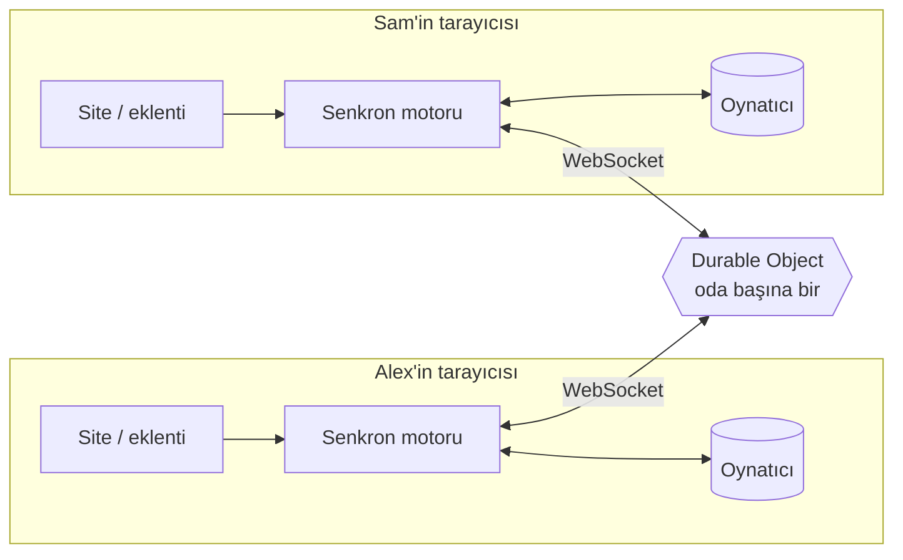

<div align="center">

# ▶ Sidelit

_Eski adıyla ScreenWithMe._

**Herhangi bir videoyu birlikte, tam senkron izle.**<br/>
Ücretsiz · hesap yok · reklam yok · YouTube'da ve (neredeyse) her sitede çalışır.

[**Canlı site**](https://screen-with-me.swm-server.workers.dev) ·
[**Eklentiyi kur**](https://screen-with-me.swm-server.workers.dev/eklenti.html) ·
[🇬🇧 English](README.md)


</div>

---

Link at, herkes aynı saniyeyi izlesin. Biri durdurur, sarar ya da hızı değiştirirse herkeste olur. Sohbet, ses,
kameralar, emojiler, oyunlar ve ortak sıra videonun etrafında.

- **YouTube, YouTube Shorts, TikTok, Vimeo linkleri, bir podcast bölümü (arama sonuçlarında 🎧 Podcastler) ya da video dosyası** → doğrudan sitede oynar, kurulum yok. Linkin
  yoksa aynı kutuya kelime yazıp YouTube'da ara.
- **Başka herhangi bir site** (sayfada HTML5 `<video>` varsa, iframe içinde bile) → sekme o siteye gider ve
  tarayıcı eklentisiyle **odanın kendisi** üstüne açılır, video odanın oynatıcı alanına oturur. Gömülmeyi
  yasaklayan sitelerde de çalışır.

## ✨ İçinde neler var

### Birlikte izlemek
| | |
|---|---|
| ⏯️ **Sıkı senkron** | Oynat / durdur / sar / hız (0,25×–4×, YouTube'da en çok 2×) herkeste. Sunucu saatine dayalı, gerçek oynatıcılarda **30–100 ms** fark ölçüldü; küçük kaymalar ±%5 hızlı ya da yavaş oynatılarak sessizce kapatılır. Yeni bir video kısa bir "3, 2, 1, birlikte!" ile başlar, herkes aynı anda başlar (yönetici kapatabilir). |
| ⏳ **Herkes hazır** | Birinin videosu takılırsa oda onu bekler (en çok 12 sn). Reklam izleyen biri odayı bekletmez. |
| 🧩 **Her site** | Eklenti doğru videoyu bulur; iframe'lerin içinde, geç yüklenen ya da kaynağını değiştiren oynatıcılarda da. Tipik reklamları (kısa, sessiz döngülü ya da köşedeki küçük videolar) atlar. Yanlış video mu? **🎯 Video seç** ile sen seç. Reklam sekmeleri kapanır, yönlendirmelerde oda açık kalır (ikisi de geri alınabilir). |
| 🖼️ **Film sayfasında oda** | Sitenin oda sayfası film sayfasının üstünde bir katman olarak açılır, videonun yerinde bir boşluk kalır. **👁 Sayfayı göster** videoyu kapatan bir pencereyi kapatmak için odayı bir anlığına kenara çeker. |
| 🖥️ **Tek kumanda** | Her oynatıcı kendi çubuğunu korur (kalite, altyazı, bölümler) ve video ekranın izin verdiği kadar büyük. Bizim düğmeler tek ince rayda: mesaj, emoji, pin, oyun, mikrofon, kamera, ekran paylaşımı, ⋯ (hız, eşitle, sıradaki, yan panel) ve tam ekran. YouTube'da ray videonun yanında durur, hiç üstünde değil: fare videonun sağ kenarına gelince açılır, ayrılınca kapanır; pencerede de tam ekranda da, ondan açılan küçük pencereyle birlikte (⋯'deki ya da Ayarlar'daki "Kumandayı hep açık tut" onu sabitler); odanın notları videonun üstünde değil sohbet panelinde görünür. Klavye kısayolları için ? tuşuna bas. |
| 📱 **Shorts görünümü** | Bir Shorts ya da TikTok linki odayı dikey yapar: video ortada, arkadaşlar iki yanda oturur; mesajlar balon olarak, emojiler avatarlarından yükselir, kameralar avatar dairelerinin içinde. ↑ / ↓, fare tekerleği ya da kaydırma herkesi önceki / sonraki videoya götürür; 🔁 tekrarlar. ♾ **Shorts akışı** sırayı bir konuyla dolu tutar, **🎲 Keşfet** popüler kategorilerden seçer, **✨ Bunun gibi** oynayan videonun peşinden gider. TikTok, TikTok'un resmi oynatıcısında oynar. |
| 🔎 **YouTube araması** | Kelime yaz, 🔍 Ara'ya (ya da Enter'a) bas: sonuçlar kutunun altında açılır; birini sıraya ekle ya da hemen aç. Shorts'lar 📱 ile işaretlidir ve Shorts görünümünde açılır. API anahtarı bizim sunucumuzda kalır. |
| 🧪 **Senkron testi** | Yerleşik 12 saniyelik bir sayaç; bir rozet aranızdaki farkı gösterir. |

### Birlikte
| | |
|---|---|
| 🔗 **Tek link, hesap yok** | Oda açılınca davet penceresi hazır gelir: link ve Kopyala, Paylaş ya da WhatsApp, yanındaki arkadaşın telefonuyla okutacağı bir QR kod. Davet linki arkadaşına tek kısa bir ekran açar: kim bekliyor, ne oynuyor, adı ve avatarı, içeri tek düğme. İlk seferde üç küçük ipucu yolu gösterir. Odanın herhangi bir yerine link yapıştır (ya da sayfaya sürükle), sıraya girsin. Her odanın güzel bir adı olur ("Velvet Lounge" gibi), ana sayfa da "Kaldığın yerden devam et" der. Ad ve avatar her oda için ayrı tutulur. |
| 🎙 **Ses ve kameralar** | Sese katıl, izlerken konuş: sessize al, bas-konuş (V'yi basılı tut), kimin konuştuğunu gör. Kameralar sürükleyip boyutlandırdığın serbest pencereler, öne çıkarma düzeni ya da tek pencere; tam ekranda videonun üstüne geçer. Kişi başına ses düzeyi, yalnız senin için sessize alma ve gizleme; katılmadan önce mikrofon, kamera ve hoparlör seçtiğin bir kontrol. Ses, sayfa yenilemeye ve kısa bağlantı kopmalarına dayanır. Eşler arası ve şifreli (sunucu duymaz), en çok 6 kişi ve 4 kamera; oda, katılmadan önce seste olanların birbirinin IP adresini görebileceğini söyler. Film sayfalarında da çalışır. |
| 📺 **Ekran paylaşımı** | Ekranını, bir pencereyi ya da sekmeyi (istersen köşede kameranla) en çok 4 izleyiciye paylaş, 720p, eşler arası. Görüntü videonun içinde durur ya da sayfada istediğin yere taşınır; "keskin yazı" ya da "akıcı" kalite. Film yeniden yayını için değil. |
| 💬 **Sohbet ve emojiler** | Mesajlaşma uygulaması gibi balonlar, resimler (yapıştır ya da bırak), güvenli tıklanabilir linkler. Emoji sayfaları ve özel emojilerle (bir odaya eklenen resim / GIF'ler, istersen kendi koleksiyonunda saklanır) bir 😀 Tepki tepsisi; emojiler gönderenin adıyla yükselir. 📌 Pinler anları bir notla işaretler. |
| 🎮 **Odada oyunlar** | XOX, Dört Taş, Son Kalp (2–6 kişilik, fiş yerine can koyduğun bir kart oyunu), Çiz-Bil ve bilgi yarışması (11 konuda 400'den fazla soru, Türkçe / İngilizce). Her oyun için resimli bir kartla oyun galerisi ("Birlikte" / "Kenarda"), aynı anda en çok 4 masa; oyunlar serbest bir pencerede ya da videonun yerinde açılır, film devam eder. **Kenarda oyna:** 🍿 Büfe, sadece odanın videosu oynarken kazanan küçük bir bekleme oyunu (arkadaşlarla, seste daha çok) ve 🌱 Pencere Bahçesi, izledikçe büyüyen ve bir albümü dolduran pencere önü bitkileri ve 🎟️ Beş Kare, Türkçe ya da İngilizce her gün bir beş harfli kelime (yeşil doğru yerde, sarı kelimede var, gri kelimede yok); her biri birkaç resimli "Nasıl oynanır" kartıyla başlar; ilerlemen tarayıcında kalır (📲 "Başka cihaza taşı" onu 6 haneli bir kodla bir kez telefonuna götürür). |
| 🎵 **Sıra ve oylama** | Ekle, sırala, hemen aç; aynı anda 30 linke kadar yapıştır. 👍 oylar sırayı değiştirir; otomatik geçiş kapatılabilir. |
| ⏰ **Film saati** | Başlangıcı planla ("30 dakika sonra", "bu akşam 21:00" ya da herhangi bir saat); herkes geri sayımı görür ve video herkeste aynı anda başlar. |
| 💾 **Kayıtlı odalar ve özet** | Tek seferlik ya da adı olan kayıtlı odalar (30 gün saklanır); her videonun nerede kaldığını hatırlar. Oturumun eğlenceli bir özeti, indirilebilir bir resimle. |

### Her yerde
| | |
|---|---|
| 📱 **Telefon için** | Telefonda oda bir uygulama ekranıdır: video kenardan kenara, altında herkesin yüzü ve kameraları, sonra sohbet. ＋ ve ⋯ alttan açılan sayfalar (video ekle, oyunlar, davet, ayarlar…), geri tuşu onları kapatır; ⛶ gerçek tam ekran verir (iPhone'da da), videonun yanında ince bir düğme sütunuyla. Shorts ve oyunlar tüm ekranı alır. Film sayfaları dışında her şey telefonda çalışır. **Tablet:** dik tutunca video üstte, düğmeleri yanında, altında iki sütun (sohbet; Birlikte, Sıra ve Kişiler), sayfa hiç kaymaz; yatay tutunca oda bilgisayardaki gibi görünür. |
| 📶 **Zor ağlar** | WebSocket'lerin hiç açılmadığı ağlarda (bazı telefon hotspot'ları) oda kendiliğinden HTTP yedeğine geçer, mümkün olunca geri döner. Odaya ulaşılamazsa "Tekrar dene" ve bağlantı testi bir dokunuş uzakta. |
| 📲 **Uygulama olarak kur** | Site telefonlarda ve bilgisayarlarda uygulama olarak kurulur ve her zaman en son sürümü yükler. |
| 🎨 **Görünüm ve ses** | 11 tema (sade ve resimli), kısa bir açılış, yumuşak üretilmiş ses efektleri (dosya yok; ayarlanabilir ya da kapatılabilir). Sitede ve eklentide İngilizce ve Türkçe (varsayılan İngilizce). |

### Yönetici ve güvenlik
| | |
|---|---|
| 👑 **Oda yöneticisi** | Odaya ilk giren yöneticidir ve kuralları ⚙️ Ayarlar'da belirler: oynatmayı yalnız yönetici yönetir, kilitli sıra, emoji sınırları, yalnız yönetici yayın açar, hazır kontrolü. Yönetici 20 sn'den uzun süre yoksa yöneticilik odada en uzun süredir bulunana geçer. Yönetici yöneticiliği başkasına devredebilir (Kişiler'de 👑), kişileri odadan çıkarabilir ve yasaklayabilir; "İçeri almadan önce sor" açıkken yeni gelen biri, yönetici içeri alana ya da reddedene kadar kapıda bekler. |
| 🔐 **Gizlilik temelden** | Video her kişinin kendi tarayıcısında oynar; sunucu yalnızca küçük "12:34'te durdur" mesajlarını ve odanın sohbetini iletir. Eklenti oda dışında uyur, film sayfası hangi odada olduğunu okuyamaz. Kullanıcı metni hiçbir zaman HTML olarak yazılmaz; sınırlar (IP başına da), köken kontrolü, sıkı bir Content-Security-Policy ve çerçeve koruması siteyi korur. |

## 🧠 Nasıl çalışır?



- **Sunucu tek doğru kaynak.** Odanın durumu sadece `{ item, paused, position, rate, updatedAt }`;
  şu anki konum `position + (sunucuSaati − updatedAt) × rate`. Mesaj sadece biri bir şey *yapınca* gider.
- **Saat eşitleme.** İstemciler birkaç ping/pong ile sunucu saatini tahmin eder (mini NTP), bütün hesap sunucu saatinde.
- **"Bunu kullanıcı mı yaptı, ben mi?"** Motor oynatıcıya komut verince hangi olayı beklediğini not eder
  (ör. bir `pause`). Beklenen olaylar kısa süre yok sayılır; beklenmeyen her şey kullanıcı hareketidir.
  Böylece yankı döngüsü olmaz, gerçek bir durdurma da kaybolmaz.
- **Sarma**, zamandaki beklenmedik sıçramadan anlaşılır (YouTube sarma olayı vermez).
- **Kayma** 1 sn'den büyükse yerine atlar; küçüğü ±%5 hızlı/yavaş oynatarak kapanır.
- **Oda başına bir Durable Object**: odalar birbirinden bağımsız büyür; WebSocket Hibernation ile boştaki oda
  maliyetsizdir. Uykudan sağ çıkması gereken zamanlayıcılar (bekleme süresi, planlı başlangıç, oda silme) tek bir depo alarmında.
- **WebSocket geçirmeyen ağlar** (bazı telefon hotspot'ları): WebSocket 6 sn içinde açılmazsa istemci kendiliğinden
  HTTP yedek bağlantısına geçer (odanın söyleyeceklerini bekleyen bir istek, bizimkiler için küçük gönderimler); mesajlar
  ve kurallar aynıdır; WebSocket yeniden açılınca ona döner.

### Tek paragrafta eklenti
Kendi arayüzü ve oda bağlantısı olmayan bir Manifest V3 eklentisi. Odada bir sayfa açılınca site sekmeyi oraya
gönderir; film sayfasında eklenti `shell.html`'i tam ekran katman olarak açar, o da odayı arka plandan öğrenip
sitenin oda sayfasını (`/r/ODA?shell=1`) yükler. Oda bağlantısını site tutar; eklenti sadece aracıdır: her
çerçevedeki içerik betiği en iyi videosunu bildirir, arka plan kazananı seçer ve sitedeki senkron motorunun
aynısı orada çalışır, oynatma mesajları siteye gider, odanın durumu geri gelir. Site oynatıcı alanının yerini
bildirir; üst çerçeve orada bir delik keser (`clip-path`) ve filmin oynatıcısını içine oturtur.

## 🧪 Kalite

| Kontrol | Neyi kapsıyor |
|---|---|
| Birim testleri (`npm test`) | 256 geçiyor: sahte saat ve oynatıcıyla senkron motoru, protokol doğrulama, oda kuralları, herkes hazır, oyun kuralları, ses kuralları, HTTP yedeği, özet, video puanlama |
| Uçtan uca (`npm run e2e`, CI'da önce yerel sonra canlı sunucuya karşı) | Gerçek sunucu koduna karşı sahte kullanıcılar: sıra, sohbet, resimler, yönetici ve odadan çıkarma, devir, herkes hazır, pinler, özel emojiler, yönetici modları, kayıtlı odalar, özet, Shorts, arama, ses / yayın sinyalleşmesi, bütün oyunlar, HTTP yedeği |
| Eklentiyle gerçek Chrome (`scripts/harness/embed`) | Film sayfasındaki oda katmanı: boşluğun yerleşmesi, sayfanın hiç görünmemesi, saydam mesajlar, filmin kendi çubuğunun korunması, dock, video seçimi, reklam sekmeleri, yönlendirmeler, ön-reklamlar |
| Gerçek ses, kamera ve yayın (`scripts/harness/voice`) | Sahte cihazlı iki Chrome: gelen sesin enerjisi ve kamera kareleri ölçülür, sitede ve film sayfalarında; serbest kamera / yayın pencereleri; doğrudan bağlantıyı engelleyen tarayıcılar |
| Telefon, Shorts, YouTube odası, TikTok, sesler, hotspot (`scripts/harness/*`) | iPhone ve Android düzenleri, birçok ekran boyutunda Shorts rayı, YouTube oynatıcısının üstünde hiçbir şey olmaması, TikTok oynatıcısının mesaj dilini konuşan bir taklit, hangi seslerin gerçekten çaldığı, WebSocket'leri yutan bir ara sunucu |
| Gerçek oynatıcılar (herkese açık demo sayfalarında eklenti kodu) | **Plyr, hls.js, Video.js**: bulma ✓, uzaktan ve yerel hareketler ✓, 26–100 ms fark |

## 🛠️ Teknoloji

Her yerde TypeScript (strict), ön yüz çatısı yok · Vite · Cloudflare Workers + Durable Objects
(SQLite tabanlı, WebSocket Hibernation) · Chrome Manifest V3 + esbuild · Vitest · GitHub Actions.

```
packages/shared   protokol + doğrulama, oda kuralları, senkron motoru, saat, bağlantı, link tanıma,
                  herkes hazır, özet, video puanlama, logo
apps/server       Worker + Durable Object (oda başına bir)
apps/web          site (sade TS/HTML/CSS)
apps/extension    tarayıcı eklentisi (arka plan, içerik betiği, oda katmanı "shell", site köprüsü, popup)
scripts/          uçtan uca testler, gerçek Chrome eklenti testi, simge / tema çizimi / avatar üreticileri
store/            Chrome Web Store paketi ve ekran görüntüleri
```

## 🚀 Geliştirme

Node.js 20+ gerekir (CI 24 kullanır).

```bash
npm install
npm run dev          # sunucu :8787 + site :5173 (/api yönlendirilir)
npm test             # birim testleri
npm run typecheck
npm run e2e          # yerel sunucuya karşı uçtan uca
```

Eklenti: `npm run build:extension:dev`, sonra `chrome://extensions` → Geliştirici modu → **Paketlenmemiş öğe yükle** →
`apps/extension/dist`.

Yayın: `main`'e gelen her değişiklik GitHub Actions'ta test edilip yüklenir (`CLOUDFLARE_API_TOKEN` ve
`CLOUDFLARE_ACCOUNT_ID` depo sırları gerekir), ardından canlı sunucuya karşı uçtan uca testler koşar.
Yerelden: bir kere `npx wrangler login`, sonra `npm run deploy`.

## 🗺️ Sırada ne var?

Chrome Web Store yayını, yeni oyunlar, kısa alan adı, Firefox; 1.0'dan sonra Google Cast ile TV sürümü (telefon
kumanda olur).

## 📄 Lisans ve gizlilik

[MIT](LICENSE) © 2026 Alperen Aktürk. Kullanıcıya giden bütün kod (site, sunucu, eklenti) bizim; derleme araçları
MIT / Apache-2.0. Gizlilik politikası: [privacy.html](https://screen-with-me.swm-server.workers.dev/privacy.html?lang=tr)
(hesap yok, takip yok; tek seferlik oda boşaldıktan 24 saat sonra, kayıtlı oda 30 gün sonra silinir).
Sorular ve sorun giderme: [yardım sayfası](https://screen-with-me.swm-server.workers.dev/help.html?lang=tr).

## ⚠️ Sınırlar

- DRM korumalı yayın servisleri henüz desteklenmiyor.
- Eklenti henüz Chrome Web Store'da değil (elle kurulum, yaklaşık bir dakika).
- Eklenti Chromium tabanlı masaüstü tarayıcılarda çalışır (Chrome, Edge, Brave, Opera, Vivaldi). Site Firefox ve Safari'de de açılır (YouTube ya da video dosyası olan odalar, sohbet, oyunlar, sesli sohbet); başka sitelerdeki sayfalar için eklentili bir masaüstü Chromium tarayıcı gerekir.
- Sidelit hiçbir video içeriğini barındırmaz ya da aktarmaz; sadece herkesin kendi açtığı oynatıcıları eşitler.
