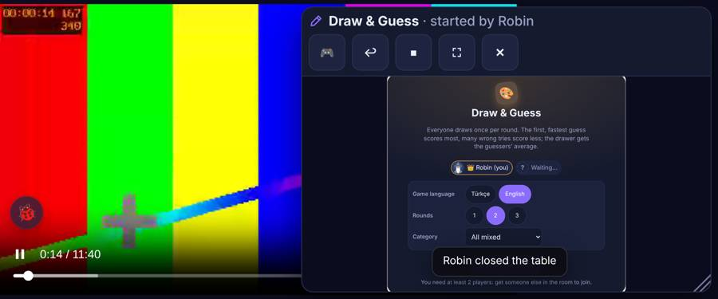
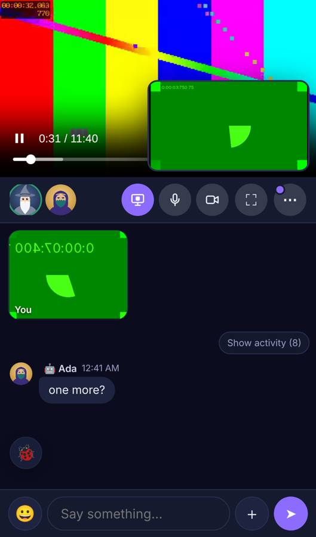
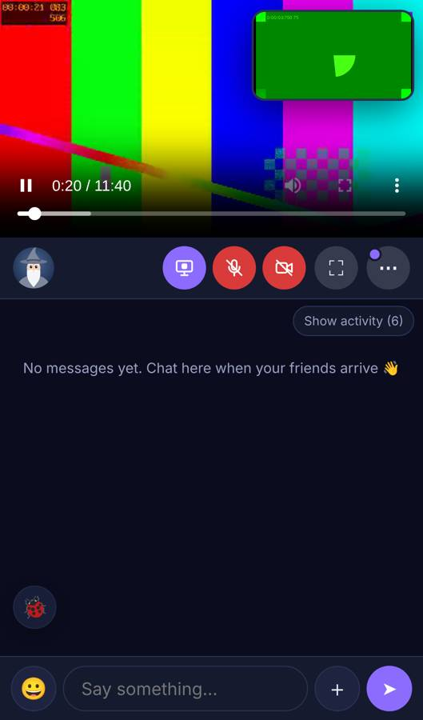
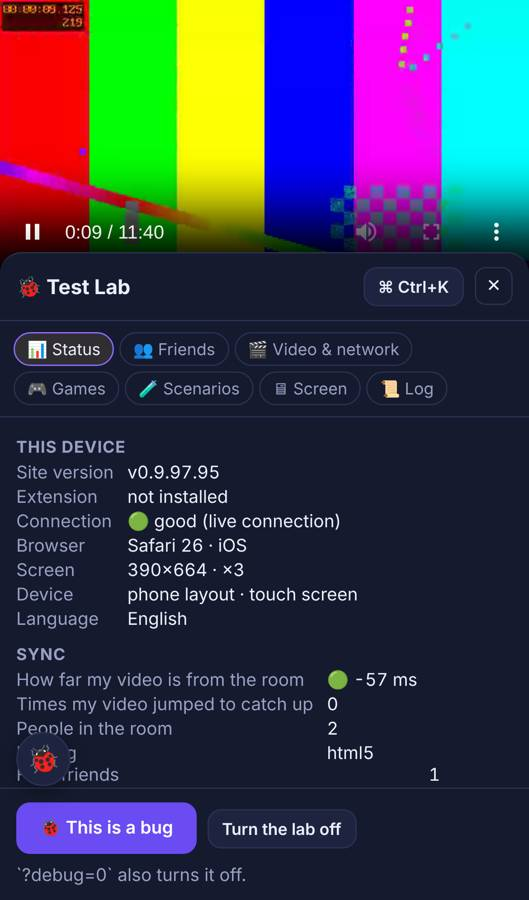
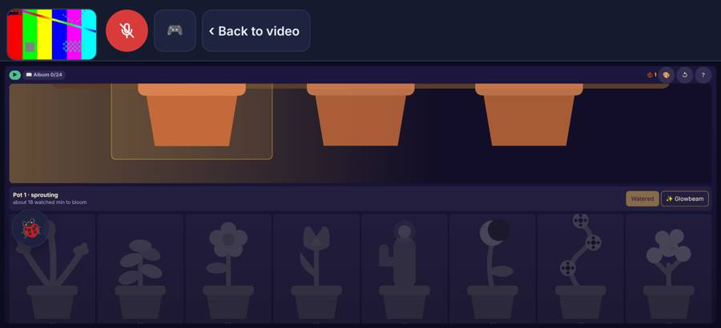
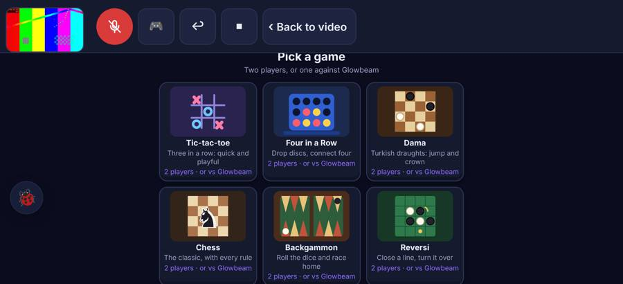
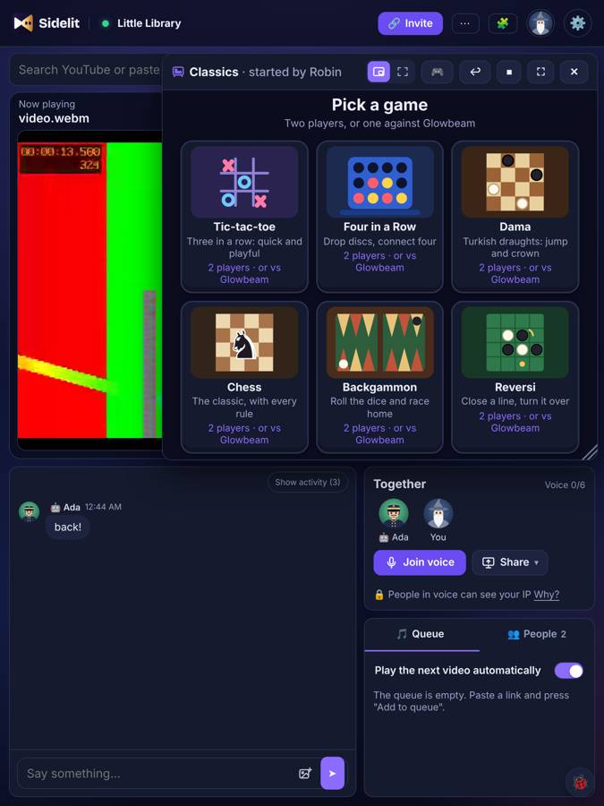
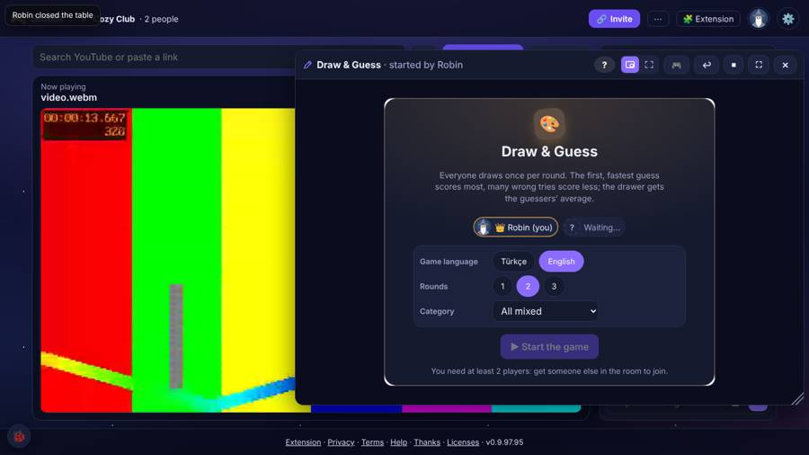
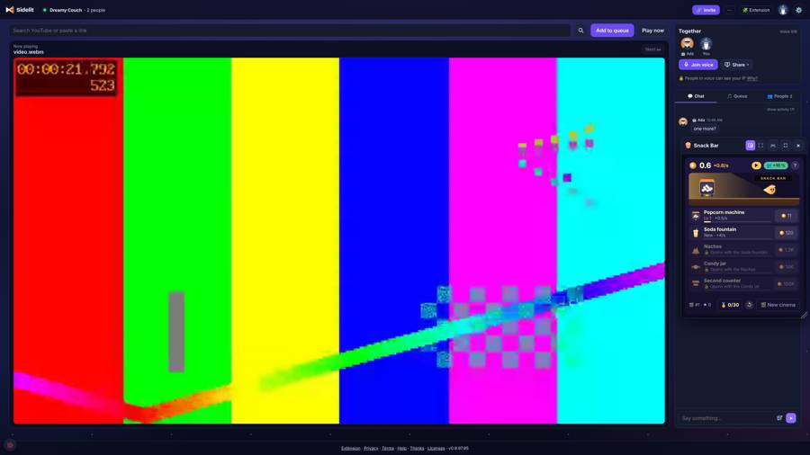
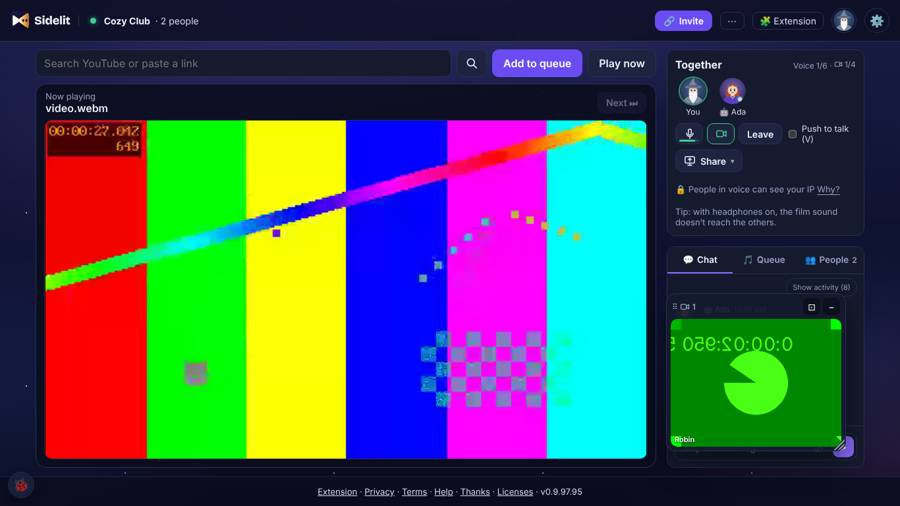

# Layout audit (card LAYOUT1, 10 Nov 2026)

Where each window of the room opens on each kind of device, and whether that makes sense. The measurements come from
`scripts/harness/layout-audit/run.cjs`. It runs a room with a playing video file and a Test Lab friend, then opens every
window in turn: rail, a chat message, invite, settings, Test Lab, all 5 tables + Classics + Sea Battle + the 3 side games,
the camera, my screen stream, and the Shorts view. For each window it records:

- the box;
- the mode (whole screen, the video's place, a free window, a bottom sheet);
- whether the window is inside the screen, whether the screen cuts off any of its controls, whether it covers the rail,
  and whether the page scrolls.

Run it again after any layout change:

```bash
NODE_PATH=$(npm root -g) node scripts/harness/layout-audit/run.cjs http://localhost:8787 http://localhost:5300/video.webm /tmp/la
```

`DEVICES=` and `STEPS=` narrow a run.

**Devices.** All emulated in Playwright:

| Name | Model and screen |
| --- | --- |
| iphone | iPhone 13, 390 × 664 |
| iphone-side | iPhone 13 sideways, 750 × 342 |
| pixel | Pixel 7, 412 × 839 |
| pixel-side | Pixel 7 sideways, 863 × 360 |
| ipad | iPad 7, 810 × 1080 |
| ipad-side | iPad 7 sideways, 1080 × 810 |
| laptop | 1366 × 768 |
| desktop | 1920 × 1080 |
| wide | 2560 × 1440 |

## Where things open

"Video" means the video's place. "Free" means a free window: draggable, resizable, and remembered. "Sheet" means a
bottom sheet. "Full" means the whole screen.

### Phones

| Window | iPhone upright | Pixel upright | iPhone sideways | Pixel sideways |
| --- | --- | --- | --- | --- |
| Video | top, 390 × 219 | top, 412 × 232 | left, 508 × 286 | left, 621 × 349 |
| Room controls | faces strip under the video | same | none: video + "Watch fullscreen" (owner's 8B) | same |
| Chat message | in the chat panel | same | not shown (8B) | same |
| Invite | centred card | same | centred card | same |
| Settings | full page | same | full page | same |
| Test Lab | sheet, 72 % tall | same | sheet | same |
| Every table and side game | full | full | full | **free window (fixed: now full)** |
| Cameras | the camera row under the faces | same | hidden (8B) | same |
| My stream preview | in the video, **bottom right over the player's bar (fixed: top right, 150 px)** | same | in the video | same |
| Shorts view | 340 × 604 | 412 × 732 | 192 × 342 | 203 × 360 |

### Tablets

| Window | iPad upright (`tablet-up`) | iPad sideways (computer layout) |
| --- | --- | --- |
| Video | 764 × 430 at the top | 703 × 396, rail beside it |
| Rail | beside the video, 58 px | same |
| Chat message | the chat column under the video | the side column |
| Invite / settings | centred dialog / full page dialog | same |
| Test Lab | sheet, 42 % tall | right drawer, 400 px |
| Tables | free window over the video and the rail (Planner's A, card T) | free window over the video and the rail |
| Side games | free window, 380–400 px, over the video | same |
| Cameras | one window, bottom right | same |
| My stream preview | in the video | same |
| Shorts view | 422 × 750 | 433 × 770 |

### Computers

| Window | Laptop 1366 × 768 | Desktop 1920 × 1080 | Wide 2560 × 1440 |
| --- | --- | --- | --- |
| Video | 916 × 515 (45 % of the screen) | 1422 × 800 (55 %) | 2062 × 1160 (65 %) |
| Rail | at the video's right edge, 58 px | same | same |
| Chat message | the chat panel (side column) | same | same |
| Invite | centred card, 440 × 342 | same size (7 %) | same size (4 %) |
| Test Lab | right drawer, 400 px (the page makes room) | same | same |
| Tables | free window, right side, over the chat column (32–49 % of the screen) | same, 16–25 % | same, 9–14 % |
| Side games | free window, 400 px, right side, over the chat column | same (11 %) | same (6 %) |
| Cameras | one window over the chat column's foot (273 × 240) | 384 × 324 | 512 × 420 |
| My stream preview | in the video, 36 % of its width | same | same |
| Shorts view | 410 × 728 | 550 × 977 | 619 × 1100 |

No window leaves the screen, and the page never scrolls, on any of the 9 devices.

## Silly things found, and what happened to them

1. **Fixed: a sideways Pixel played games in a free window.** A tall phone held sideways is wider than 860 px (Pixel 7:
   863 px). So `games/stage.ts` took it for a computer and opened a 217–493 px free window over the 621 px video. A
   750 px iPhone got the whole screen. Now a phone is always "narrow" (`isPhoneLayout()`), so every game is full screen
   held either way. Harness: "the whole screen on a phone" for the 4 phone profiles × 8 games.
   
2. **Fixed: on a phone my own stream preview covered the player's bar.** The preview started in the video's bottom
   right at 200 px wide, which is 51 % of a 390 px video. It sat on the play button, time and seek line of the video
   file's own bar. Now it starts in the top right (`live-float.ts` default `y: 0.04`) and is at least 150 px wide on a
   phone, not 200 px. Harness: "stream: clear of the player's bar" on every device. `voice/live.mjs` now drags it down
   and left instead of up.
    
3. **Fixed: 🐞 sat on the Test Lab sheet's rows on a phone.** The button stays where it is, and the open sheet covered
   the bottom-left rows under it. Now it hides while the sheet is open on a phone; the sheet's ✕ closes it. Harness:
   "lab: 🐞 hidden while the sheet is open".
   
4. **For Game Studio: a sideways phone cuts off two games.** Both run at full screen, but at 342–360 px tall:
   - Window Garden: the pots are drawn above the screen's top edge (y −79 to −116). Only their bottom halves show.
   - Classics: the game shelf's second row of boxes is under the bottom edge, and the shelf does not scroll.

   These are the games' own layouts, so they are listed for Game Studio. The audit harness still reports them, so it
   fails until they are fixed.
    
5. **For Game Studio / Design: two look-alike "fullscreen" icons in a game window's head.** The place switch's
   "in the video's place" icon and the "⛶ fullscreen" button are both four corners, side by side.
   
6. **Noted, not changed: contrast.** See THEME1. The contrast harness found that my own chat bubble in
   Gece is 3.7:1 (white on `--accent`), which is under AA.

## Choices for the owner (through the Planner)

These are preferences, not bugs. A and C wait for the owner; B, D and E were decided by the Planner:

- **A. Where a free game window opens on a computer.** Today it opens at the right and covers the chat column (laptop:
  32–49 % of the screen), while the people playing chat about the game.
  - A1: keep it as it is.
  - A2: open over the video's left part, so the chat stays readable.
  - A3: open in the video's place by default (the video goes small), as on an upright tablet.

  
- **B. Decided (Planner, 10 Nov): B2, shipped in 0.9.97.96.** A free game window grows with the screen until I resize
  it: `min(width / 1366, height / 768)` of the game's size, at most its largest size. Before, a side game was 6 % of a
  2560 × 1440 screen. Card GP's harness now checks the new rule. Layout harness: "grows with the screen".
  
- **C. Where the camera window starts on a computer.** It starts over the foot of the chat column and covers the message
  box ("Say something…"). It can be dragged, and the place is remembered.
  - C1: keep it as it is.
  - C2: start over the video's bottom-left corner, like Meet's self-view.
  - C3: start over the chat column but above the message box.

  
- **D. Decided (Planner): keep.** Tables on an upright tablet stay a free window over the video.
- **E. Decided (Planner): shipped in 0.9.97.96.** Dialogs grow a little on big screens (`zoom` 1.2 from 2200 × 1100,
  1.35 from 2500 × 1300; not settings or the image viewer). The invite card is 594 px wide on a 2560 screen, 440 px on
  a laptop. Layout harness: "invite: grows on a big screen".

## What the contrast harness says (THEME1, report only for now)

`scripts/harness/contrast/run.cjs` checks every theme on these pages: home, help, join, room, settings, and the games
hall. It runs on a laptop for all 10 themes, and on a phone for the 4 plain themes. It compares each text line's colour
with the real background pixels under it (scene pictures included) against WCAG AA. The first run, on 0.9.97.95, found:

- **Gece:** my own chat bubble is 3.7:1 (white on `#8b6cff`). The games hall tab count is 3.7:1.
- **Every theme:** the "How it works" peek at the foot of the home screen is between 1.0 and 4.5:1, depending on the
  theme.
- **Gemi:** 8 lines fail on home (slogan, sub line, Join with a code, Save the room, Shorts door). The light sky behind
  the text needs a backdrop.
- **Lokum, Bin Bir Gece, Tren, Okyanus, Gün Batımı:** 1–3 lines each, all on the home page's scene: the save box, the
  Shorts door, Questions?

The room, join card, settings and help pass in every theme except the Gece bubble above. The fixes wait for Design's
`themes-2.md` (card THEME1). Run it with `REPORT_ONLY=1` until then.
